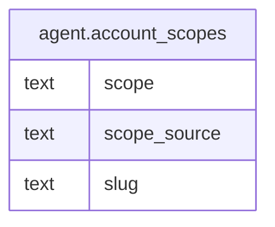

# agent.account_scopes

## Description

One row per account (slug, scope, scope_source). The scope is the first rule that applies: (1) the operator's setting in core.account.scope (scope_source setting); (2) for a pot, its parent account's scope (parent); (3) from the account type: joint gives joint, business gives business (type); (4) otherwise personal (default). Step 3 suits Monzo, whose types are reliable. An Open Banking joint account whose display name is not exactly "joint", and any statement-fed joint or business account, needs the operator's setting. Ended accounts have a scope too.

<details>
<summary><strong>Table Definition</strong></summary>

```sql
CREATE VIEW account_scopes AS (
 WITH own AS (
         SELECT a.id,
            a.slug,
            a.type,
            a.parent_id,
                CASE
                    WHEN (a.scope IS NOT NULL) THEN a.scope
                    WHEN (a.type = 'joint'::text) THEN 'joint'::text
                    WHEN (a.type = 'business'::text) THEN 'business'::text
                    ELSE 'personal'::text
                END AS scope,
                CASE
                    WHEN (a.scope IS NOT NULL) THEN 'setting'::text
                    WHEN (a.type = ANY (ARRAY['joint'::text, 'business'::text])) THEN 'type'::text
                    ELSE 'default'::text
                END AS scope_source
           FROM account a
        )
 SELECT o.slug,
        CASE
            WHEN ((o.scope_source <> 'setting'::text) AND (o.type = 'pot'::text) AND (p.id IS NOT NULL)) THEN p.scope
            ELSE o.scope
        END AS scope,
        CASE
            WHEN ((o.scope_source <> 'setting'::text) AND (o.type = 'pot'::text) AND (p.id IS NOT NULL)) THEN 'parent'::text
            ELSE o.scope_source
        END AS scope_source
   FROM (own o
     LEFT JOIN own p ON ((p.id = o.parent_id)))
)
```

</details>

## Columns

| Name | Type | Default | Nullable | Children | Parents | Comment |
| ---- | ---- | ------- | -------- | -------- | ------- | ------- |
| scope | text |  | true |  |  |  |
| scope_source | text |  | true |  |  |  |
| slug | text |  | true |  |  |  |

## Referenced Tables

| Name | Columns | Comment | Type |
| ---- | ------- | ------- | ---- |

## Relations



---

> Generated by [tbls](https://github.com/k1LoW/tbls)
