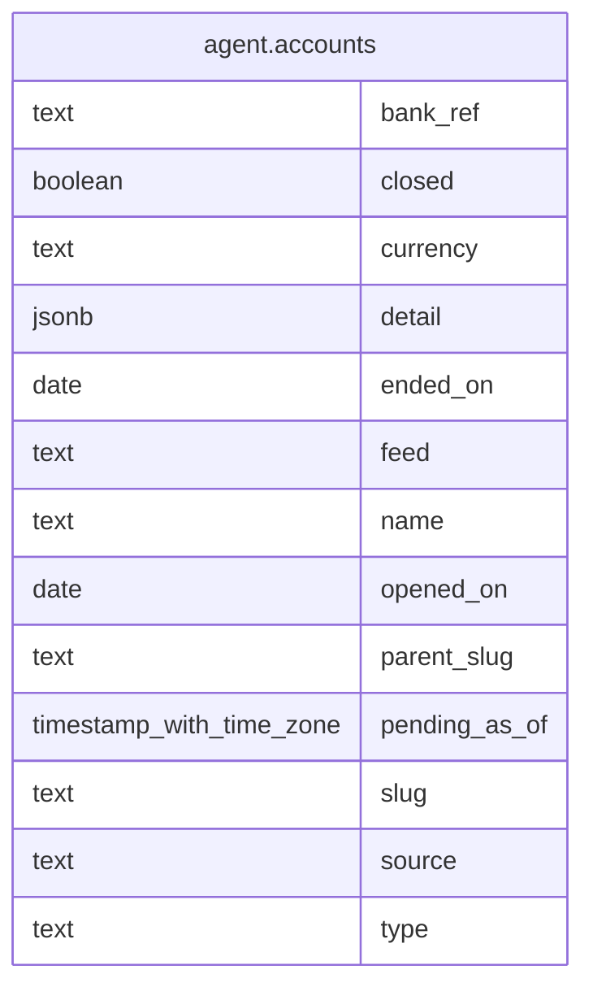

# agent.accounts

## Description

One row per account or pot finstore holds, with its source, type, feed (api or file), currency, name, parent_slug, opened_on, closed, bank_ref, ended_on and pending_as_of. detail is the latest account or pot object the source gave (Monzo: the newest readable /accounts or /pots response; TrueLayer: the object the bank listed newest; null for a file-fed account); it holds account numbers, sort codes and names. pending_as_of is when the newest pending response for the account was fetched, null when no pending read has succeeded. Closed accounts and deleted pots are kept.

<details>
<summary><strong>Table Definition</strong></summary>

```sql
CREATE VIEW accounts AS (
 WITH request AS (
         SELECT DISTINCT api_response.endpoint,
            api_response.params,
                CASE api_response.endpoint
                    WHEN '/accounts'::text THEN 'accounts'::text
                    ELSE 'pots'::text
                END AS list_key
           FROM api_response
          WHERE ((api_response.source = 'monzo'::text) AND (api_response.endpoint = ANY (ARRAY['/accounts'::text, '/pots'::text])) AND (api_response.status = 200))
        ), latest_doc AS (
         SELECT q.endpoint,
            d.seq,
            d.fetched_at,
            d.list
           FROM (request q
             CROSS JOIN LATERAL ( SELECT s.seq,
                    s.fetched_at,
                    b.list
                   FROM (( SELECT r.seq,
                            r.fetched_at
                           FROM api_response r
                          WHERE ((r.source = 'monzo'::text) AND (r.endpoint = q.endpoint) AND (r.params = q.params) AND (r.status = 200))
                          ORDER BY r.fetched_at DESC, r.seq DESC
                         OFFSET 0) s
                     CROSS JOIN LATERAL ( SELECT (json_body(r.body) -> q.list_key) AS list
                           FROM api_response r
                          WHERE (r.seq = s.seq)
                         OFFSET 0) b)
                  WHERE (jsonb_typeof(b.list) = 'array'::text)
                 LIMIT 1) d)
        ), monzo_object AS (
         SELECT DISTINCT ON (d.endpoint, (o.value ->> 'id'::text)) d.endpoint,
            (o.value ->> 'id'::text) AS id,
            o.value AS obj
           FROM (latest_doc d
             CROSS JOIN LATERAL jsonb_array_elements(
                CASE
                    WHEN (jsonb_typeof(d.list) = 'array'::text) THEN d.list
                    ELSE '[]'::jsonb
                END) o(value))
          ORDER BY d.endpoint, (o.value ->> 'id'::text), d.fetched_at DESC, d.seq DESC
        )
 SELECT a.slug,
    a.source,
    a.type,
    a.feed,
    a.currency,
    a.name,
    p.slug AS parent_slug,
    a.opened_on,
    a.closed,
    COALESCE(m.obj, a.detail) AS detail,
    a.bank_ref,
    a.ended_on,
    ps.as_of AS pending_as_of
   FROM (((account a
     LEFT JOIN account p ON ((p.id = a.parent_id)))
     LEFT JOIN monzo_object m ON (((a.source = 'monzo'::text) AND (a.feed = 'api'::text) AND (m.id = a.source_key) AND (m.endpoint =
        CASE
            WHEN (a.type = 'pot'::text) THEN '/pots'::text
            ELSE '/accounts'::text
        END))))
     LEFT JOIN pending_snapshot ps ON ((ps.account_id = a.id)))
)
```

</details>

## Columns

| Name | Type | Default | Nullable | Children | Parents | Comment |
| ---- | ---- | ------- | -------- | -------- | ------- | ------- |
| bank_ref | text |  | true |  |  |  |
| closed | boolean |  | true |  |  |  |
| currency | text |  | true |  |  |  |
| detail | jsonb |  | true |  |  |  |
| ended_on | date |  | true |  |  |  |
| feed | text |  | true |  |  |  |
| name | text |  | true |  |  |  |
| opened_on | date |  | true |  |  |  |
| parent_slug | text |  | true |  |  |  |
| pending_as_of | timestamp with time zone |  | true |  |  |  |
| slug | text |  | true |  |  |  |
| source | text |  | true |  |  |  |
| type | text |  | true |  |  |  |

## Referenced Tables

| Name | Columns | Comment | Type |
| ---- | ------- | ------- | ---- |
| [raw.api_response](raw.api_response.md) | 10 |  | BASE TABLE |

## Relations



---

> Generated by [tbls](https://github.com/k1LoW/tbls)
