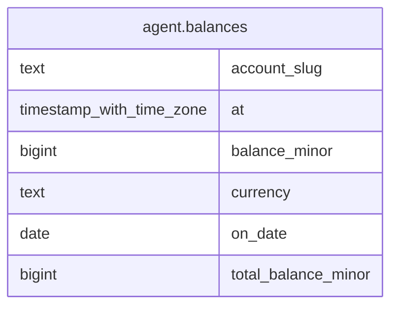

# agent.balances

## Description

Balance readings per account: balance_minor and total_balance_minor in integer minor units (pence) with currency, at the instant (at) or day (on_date) the bank reported. Readings of an ended account after its ended_on are left out.

<details>
<summary><strong>Table Definition</strong></summary>

```sql
CREATE VIEW balances AS (
 SELECT a.slug AS account_slug,
    b.at,
    b.on_date,
    b.balance_minor,
    b.total_balance_minor,
    b.currency
   FROM (balance_snapshot b
     JOIN account a ON ((a.id = b.account_id)))
  WHERE ((a.ended_on IS NULL) OR (COALESCE(b.on_date, ((b.at AT TIME ZONE 'Europe/London'::text))::date) <= a.ended_on))
)
```

</details>

## Columns

| Name | Type | Default | Nullable | Children | Parents | Comment |
| ---- | ---- | ------- | -------- | -------- | ------- | ------- |
| account_slug | text |  | true |  |  |  |
| at | timestamp with time zone |  | true |  |  |  |
| balance_minor | bigint |  | true |  |  |  |
| currency | text |  | true |  |  |  |
| on_date | date |  | true |  |  |  |
| total_balance_minor | bigint |  | true |  |  |  |

## Referenced Tables

| Name | Columns | Comment | Type |
| ---- | ------- | ------- | ---- |

## Relations



---

> Generated by [tbls](https://github.com/k1LoW/tbls)
