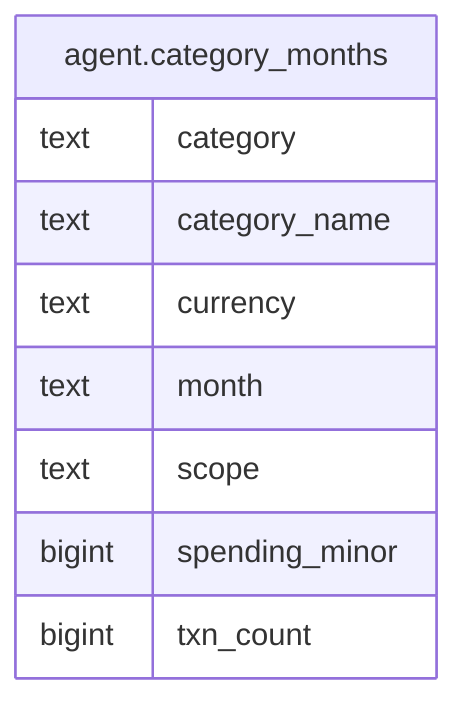

# agent.category_months

## Description

One row per month (YYYY-MM of txn_date), account scope, currency and category, over settled transactions of class spending in agent.cash_flows: spending_minor (pence, positive) and txn_count. category is the payee's category setting, else the transaction's own category (null when it has neither); category_name is the operator's name for it. Pending rows are not counted.

<details>
<summary><strong>Table Definition</strong></summary>

```sql
CREATE VIEW category_months AS (
 SELECT to_char((txn_date)::timestamp with time zone, 'YYYY-MM'::text) AS month,
    account_scope AS scope,
    currency,
    category,
    category_name,
    (sum((- amount_minor)))::bigint AS spending_minor,
    count(*) AS txn_count
   FROM cash_flows c
  WHERE ((status = 'settled'::text) AND (flow_class = 'spending'::text))
  GROUP BY (to_char((txn_date)::timestamp with time zone, 'YYYY-MM'::text)), account_scope, currency, category, category_name
)
```

</details>

## Columns

| Name | Type | Default | Nullable | Children | Parents | Comment |
| ---- | ---- | ------- | -------- | -------- | ------- | ------- |
| category | text |  | true |  |  |  |
| category_name | text |  | true |  |  |  |
| currency | text |  | true |  |  |  |
| month | text |  | true |  |  |  |
| scope | text |  | true |  |  |  |
| spending_minor | bigint |  | true |  |  |  |
| txn_count | bigint |  | true |  |  |  |

## Referenced Tables

| Name | Columns | Comment | Type |
| ---- | ------- | ------- | ---- |

## Relations



---

> Generated by [tbls](https://github.com/k1LoW/tbls)
