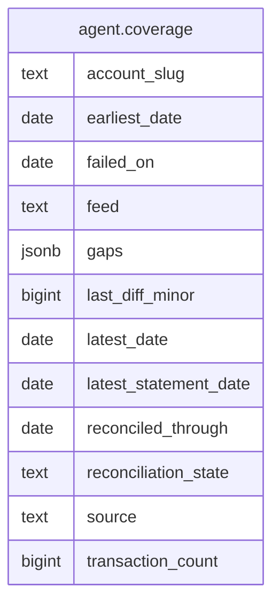

# agent.coverage

## Description

One row per account: the earliest and latest transaction dates held, the transaction count, reconciliation_state (reconciled, mismatch, balances_only or not_checked: whether the stored transactions agree with the bank balance), reconciled_through, last_diff_minor and gaps. gaps is a JSON array of runs of days (from and to inclusive) that nothing covers, each with a reason; today is never a gap. Check it before stating a total for an account. source says where the data comes from: monzo, truelayer:<provider>, investment:<provider> or the file source. An ended account counts only rows up to its ended_on. A platform account is left out; an investment account has its dates from its events, a transaction_count of 0, a null latest_statement_date, and is import due when its newest valuation is over 70 days old.

<details>
<summary><strong>Table Definition</strong></summary>

```sql
CREATE VIEW coverage AS (
 WITH today AS (
         SELECT ((now() AT TIME ZONE 'Europe/London'::text))::date AS d
        ), txn AS (
         SELECT t.account_id,
            min(t.txn_date) AS earliest,
            max(t.txn_date) AS latest,
            count(*) AS n
           FROM (transaction t
             JOIN account a_1 ON ((a_1.id = t.account_id)))
          WHERE ((t.disappeared_at IS NULL) AND ((a_1.ended_on IS NULL) OR (t.txn_date <= a_1.ended_on)))
          GROUP BY t.account_id
        ), investment_dates AS (
         SELECT e.account_id,
            min(COALESCE(e.settle_date, e.order_date)) AS earliest,
            max(COALESCE(e.settle_date, e.order_date)) AS latest
           FROM (investment_event e
             JOIN account a_1 ON ((a_1.id = e.account_id)))
          WHERE ((e.disappeared_at IS NULL) AND ((a_1.ended_on IS NULL) OR (COALESCE(e.settle_date, e.order_date) <= a_1.ended_on)))
          GROUP BY e.account_id
        ), fetch_days AS (
         SELECT p.account_id,
            ((p.period_start AT TIME ZONE 'Europe/London'::text))::date AS first_day,
            (((p.period_end - '00:00:00.000001'::interval) AT TIME ZONE 'Europe/London'::text))::date AS last_day
           FROM fetch_period p
          WHERE (p.period_end > p.period_start)
        UNION ALL
         SELECT a_1.id,
            ((w.period_start AT TIME ZONE 'Europe/London'::text))::date AS timezone,
            (((LEAST(w.period_end, w.completed_at) - '00:00:00.000001'::interval) AT TIME ZONE 'Europe/London'::text))::date AS timezone
           FROM (backfill_window w
             JOIN account a_1 ON (((a_1.feed = 'api'::text) AND (a_1.source_key = w.account_key))))
          WHERE ((w.completed_at IS NOT NULL) AND (LEAST(w.period_end, w.completed_at) > w.period_start))
        ), covered AS (
         SELECT fetch_days.account_id,
            range_agg(daterange(fetch_days.first_day, fetch_days.last_day, '[]'::text)) AS days,
            min(fetch_days.first_day) AS first_day,
            max(fetch_days.last_day) AS last_day
           FROM fetch_days
          GROUP BY fetch_days.account_id
        ), unfinished AS (
         SELECT a_1.id AS account_id,
            range_agg(daterange(((w.period_start AT TIME ZONE 'Europe/London'::text))::date, (((w.period_end - '00:00:00.000001'::interval) AT TIME ZONE 'Europe/London'::text))::date, '[]'::text)) AS days
           FROM (backfill_window w
             JOIN account a_1 ON (((a_1.feed = 'api'::text) AND (a_1.source_key = w.account_key))))
          WHERE ((w.completed_at IS NULL) AND (w.period_end > w.period_start))
          GROUP BY a_1.id
        ), api_life AS (
         SELECT a_1.id AS account_id,
            COALESCE(a_1.opened_on, c.first_day) AS life_start,
            LEAST(
                CASE
                    WHEN a_1.closed THEN (c.last_day + 1)
                    ELSE ( SELECT today.d
                       FROM today)
                END, (a_1.ended_on + 1)) AS life_end,
            COALESCE(c.days, '{}'::datemultirange) AS covered,
            COALESCE(u.days, '{}'::datemultirange) AS unfinished
           FROM (((account a_1
             LEFT JOIN covered c ON ((c.account_id = a_1.id)))
             LEFT JOIN unfinished u ON ((u.account_id = a_1.id)))
             LEFT JOIN reconciliation r_1 ON ((r_1.account_id = a_1.id)))
          WHERE ((a_1.feed = 'api'::text) AND (a_1.type <> 'pot'::text) AND (COALESCE(r_1.method, ''::text) <> 'balances_only'::text))
        ), api_uncovered AS (
         SELECT api_life.account_id,
            api_life.unfinished,
                CASE
                    WHEN ((api_life.life_start IS NULL) OR (api_life.life_end IS NULL) OR (api_life.life_start >= api_life.life_end)) THEN '{}'::datemultirange
                    ELSE (datemultirange(daterange(api_life.life_start, api_life.life_end, '[)'::text)) - api_life.covered)
                END AS uncovered
           FROM api_life
        ), file_latest AS (
         SELECT a_1.id AS account_id,
            a_1.expects_imports,
            a_1.ended_on,
            GREATEST(( SELECT max(t.txn_date) AS max
                   FROM transaction t
                  WHERE ((t.account_id = a_1.id) AND (t.disappeared_at IS NULL) AND ((a_1.ended_on IS NULL) OR (t.txn_date <= a_1.ended_on)))), ( SELECT max(b.on_date) AS max
                   FROM balance_snapshot b
                  WHERE ((b.account_id = a_1.id) AND ((a_1.ended_on IS NULL) OR (b.on_date <= a_1.ended_on))))) AS d
           FROM account a_1
          WHERE (a_1.feed = 'file'::text)
        ), latest_statement AS (
         SELECT fl_1.account_id,
            fl_1.d
           FROM (file_latest fl_1
             JOIN account a_1 ON ((a_1.id = fl_1.account_id)))
          WHERE (fl_1.expects_imports AND (fl_1.ended_on IS NULL) AND (a_1.source !~~ 'investment:%'::text))
        ), investment_latest AS (
         SELECT a_1.id AS account_id,
            ( SELECT max(v.as_of) AS max
                   FROM valuation v
                  WHERE (v.account_id = a_1.id)) AS d
           FROM account a_1
          WHERE ((a_1.source ~~ 'investment:%'::text) AND (a_1.parent_id IS NOT NULL) AND a_1.expects_imports AND (a_1.ended_on IS NULL))
        ), shared AS (
         SELECT DISTINCT ON (a_1.id) a_1.id AS account_id,
            b.slug AS other_slug
           FROM (account a_1
             JOIN account b ON (((b.bank_ref = a_1.bank_ref) AND (b.source <> a_1.source) AND (b.ended_on IS NULL))))
          WHERE ((a_1.bank_ref IS NOT NULL) AND (a_1.ended_on IS NULL))
          ORDER BY a_1.id, b.slug
        ), gap_rows AS (
         SELECT u.account_id,
            lower(g_1.g) AS from_date,
            jsonb_build_object('from', lower(g_1.g), 'to', (upper(g_1.g) - 1), 'reason', 'the Monzo window closed before this range was fetched') AS gap
           FROM api_uncovered u,
            LATERAL unnest((u.uncovered * u.unfinished)) g_1(g)
        UNION ALL
         SELECT u.account_id,
            lower(g_1.g) AS lower,
            jsonb_build_object('from', lower(g_1.g), 'to', (upper(g_1.g) - 1), 'reason', 'no completed fetch covers this period') AS jsonb_build_object
           FROM api_uncovered u,
            LATERAL unnest((u.uncovered - u.unfinished)) g_1(g)
        UNION ALL
         SELECT fg.account_id,
            fg.after_date,
            jsonb_build_object('from', fg.after_date, 'to', fg.before_date, 'reason', 'no file covers these days', 'diff_minor', fg.diff_minor) AS jsonb_build_object
           FROM file_gap fg
          WHERE (fg.accepted_reason IS NULL)
        UNION ALL
         SELECT ls.account_id,
            (ls.d + 1),
            jsonb_build_object('from', (ls.d + 1), 'to', ( SELECT today.d
                   FROM today), 'reason', 'import due') AS jsonb_build_object
           FROM latest_statement ls
          WHERE ((ls.d IS NULL) OR ((( SELECT today.d
                   FROM today) - ls.d) > 35))
        UNION ALL
         SELECT il.account_id,
            (il.d + 1),
            jsonb_build_object('from', (il.d + 1), 'to', ( SELECT today.d
                   FROM today), 'reason', 'import due') AS jsonb_build_object
           FROM investment_latest il
          WHERE ((il.d IS NULL) OR ((( SELECT today.d
                   FROM today) - il.d) > 70))
        UNION ALL
         SELECT s.account_id,
            NULL::date AS date,
            jsonb_build_object('from', NULL::unknown, 'to', ( SELECT today.d
                   FROM today), 'reason', ('bank reference shared with '::text || s.other_slug)) AS jsonb_build_object
           FROM shared s
        ), gaps AS (
         SELECT gap_rows.account_id,
            jsonb_agg(gap_rows.gap ORDER BY gap_rows.from_date NULLS FIRST) AS gaps
           FROM gap_rows
          GROUP BY gap_rows.account_id
        )
 SELECT a.slug AS account_slug,
    a.feed,
    COALESCE(txn.earliest, inv.earliest) AS earliest_date,
    COALESCE(txn.latest, inv.latest) AS latest_date,
    COALESCE(txn.n, (0)::bigint) AS transaction_count,
        CASE
            WHEN ((a.type = 'pot'::text) OR (r.method = 'balances_only'::text)) THEN 'balances_only'::text
            WHEN ((sh.account_id IS NOT NULL) OR (r.known_exception = 'shared_bank_ref'::text)) THEN 'mismatch'::text
            WHEN ((r.last_check_ok IS FALSE) OR (COALESCE(r.break_count, 0) > 0)) THEN 'mismatch'::text
            WHEN (r.last_check_ok IS TRUE) THEN 'reconciled'::text
            ELSE 'not_checked'::text
        END AS reconciliation_state,
    COALESCE(r.reconciled_through, ((r.last_pass_at AT TIME ZONE 'Europe/London'::text))::date) AS reconciled_through,
    r.last_diff_minor,
    COALESCE(g.gaps, '[]'::jsonb) AS gaps,
    fl.d AS latest_statement_date,
    r.failed_on,
    a.source
   FROM ((((((account a
     LEFT JOIN txn ON ((txn.account_id = a.id)))
     LEFT JOIN investment_dates inv ON ((inv.account_id = a.id)))
     LEFT JOIN reconciliation r ON ((r.account_id = a.id)))
     LEFT JOIN gaps g ON ((g.account_id = a.id)))
     LEFT JOIN file_latest fl ON ((fl.account_id = a.id)))
     LEFT JOIN shared sh ON ((sh.account_id = a.id)))
  WHERE (a.type <> 'platform'::text)
)
```

</details>

## Columns

| Name | Type | Default | Nullable | Children | Parents | Comment |
| ---- | ---- | ------- | -------- | -------- | ------- | ------- |
| account_slug | text |  | true |  |  |  |
| earliest_date | date |  | true |  |  |  |
| failed_on | date |  | true |  |  |  |
| feed | text |  | true |  |  |  |
| gaps | jsonb |  | true |  |  |  |
| last_diff_minor | bigint |  | true |  |  |  |
| latest_date | date |  | true |  |  |  |
| latest_statement_date | date |  | true |  |  |  |
| reconciled_through | date |  | true |  |  |  |
| reconciliation_state | text |  | true |  |  |  |
| source | text |  | true |  |  |  |
| transaction_count | bigint |  | true |  |  |  |

## Referenced Tables

| Name | Columns | Comment | Type |
| ---- | ------- | ------- | ---- |

## Relations



---

> Generated by [tbls](https://github.com/k1LoW/tbls)
