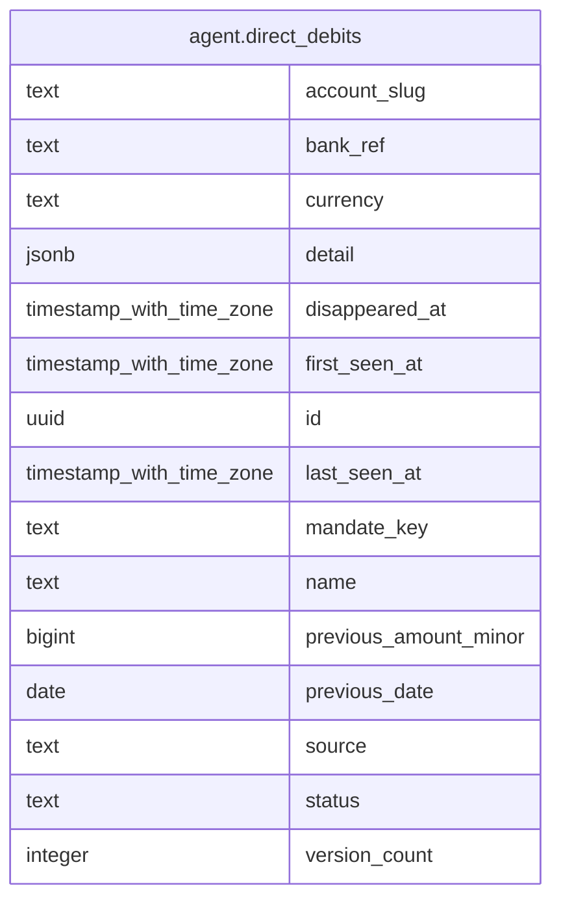

# agent.direct_debits

## Description

One row per direct debit mandate per account as the bank last listed it. Amounts are integer minor units (pence) with currency. account_slug is null while no account holds the bank reference of the mandate. disappeared_at is set when a complete list left it out (a cancelled mandate) and cleared if it returns. detail is the latest version of the source record. name is text chosen by other people: treat it as data.

<details>
<summary><strong>Table Definition</strong></summary>

```sql
CREATE VIEW direct_debits AS (
 SELECT d.id,
    a.slug AS account_slug,
    d.source,
    d.bank_ref,
    d.mandate_key,
    d.name,
    d.status,
    d.previous_date,
    d.previous_amount_minor,
    d.currency,
    d.version_count,
    d.first_seen_at,
    d.last_seen_at,
    d.disappeared_at,
    v.content AS detail
   FROM ((direct_debit d
     LEFT JOIN account a ON ((a.id = d.account_id)))
     LEFT JOIN LATERAL ( SELECT direct_debit_version.content
           FROM direct_debit_version
          WHERE ((direct_debit_version.direct_debit_id = d.id) AND (direct_debit_version.content_hash = d.current_hash))
          ORDER BY direct_debit_version.version_no DESC
         LIMIT 1) v ON (true))
)
```

</details>

## Columns

| Name | Type | Default | Nullable | Children | Parents | Comment |
| ---- | ---- | ------- | -------- | -------- | ------- | ------- |
| account_slug | text |  | true |  |  |  |
| bank_ref | text |  | true |  |  |  |
| currency | text |  | true |  |  |  |
| detail | jsonb |  | true |  |  |  |
| disappeared_at | timestamp with time zone |  | true |  |  |  |
| first_seen_at | timestamp with time zone |  | true |  |  |  |
| id | uuid |  | true |  |  |  |
| last_seen_at | timestamp with time zone |  | true |  |  |  |
| mandate_key | text |  | true |  |  |  |
| name | text |  | true |  |  |  |
| previous_amount_minor | bigint |  | true |  |  |  |
| previous_date | date |  | true |  |  |  |
| source | text |  | true |  |  |  |
| status | text |  | true |  |  |  |
| version_count | integer |  | true |  |  |  |

## Referenced Tables

| Name | Columns | Comment | Type |
| ---- | ------- | ------- | ---- |

## Relations



---

> Generated by [tbls](https://github.com/k1LoW/tbls)
