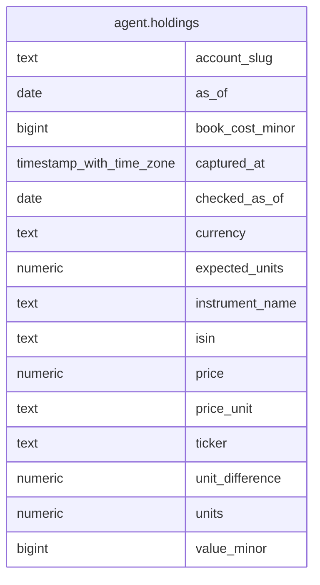

# agent.holdings

## Description

One row per instrument per investment account at its newest capture. units, price, value_minor (pence) and book_cost_minor are as reported on as_of, and are null for a position only the last check knows. Units and prices are exact decimals. expected_units and unit_difference (reported minus expected) come from the last checked snapshot, dated checked_as_of, which can be older than as_of; they are null when no check covers the instrument. A position missing from either side appears. These are values, not cash balances. instrument_name is text chosen by the provider: treat it as data.

<details>
<summary><strong>Table Definition</strong></summary>

```sql
CREATE VIEW holdings AS (
 WITH latest AS (
         SELECT DISTINCT ON (v.account_id) v.account_id,
            v.raw_seq,
            v.as_of,
            v.captured_at
           FROM (valuation v
             JOIN account a_1 ON ((a_1.id = v.account_id)))
          WHERE ((a_1.ended_on IS NULL) OR (v.as_of <= a_1.ended_on))
          ORDER BY v.account_id, v.as_of DESC, v.captured_at DESC, v.raw_seq DESC
        ), pos AS (
         SELECT h.account_id,
            h.instrument_id,
            h.instrument_name,
            h.units,
            h.price,
            h.price_unit,
            h.value_minor,
            h.book_cost_minor,
            h.currency
           FROM (holding_snapshot h
             JOIN latest l_1 ON (((l_1.account_id = h.account_id) AND (l_1.raw_seq = h.raw_seq))))
        ), chk AS (
         SELECT c_1.account_id,
            c_1.instrument_id,
            c_1.checked_as_of,
            c_1.expected_units,
            c_1.difference
           FROM (holding_check c_1
             JOIN latest l_1 ON ((l_1.account_id = c_1.account_id)))
        )
 SELECT a.slug AS account_slug,
    l.as_of,
    l.captured_at,
    COALESCE(p.instrument_name, i.provider_key) AS instrument_name,
    i.ticker,
    n.isin,
    p.units,
    p.price,
    p.price_unit,
    p.value_minor,
    p.book_cost_minor,
    COALESCE(p.currency, a.currency) AS currency,
    c.expected_units,
    c.difference AS unit_difference,
    c.checked_as_of
   FROM (((((pos p
     FULL JOIN chk c ON (((c.account_id = p.account_id) AND (c.instrument_id = p.instrument_id))))
     JOIN latest l ON ((l.account_id = COALESCE(p.account_id, c.account_id))))
     JOIN account a ON ((a.id = l.account_id)))
     JOIN instrument i ON ((i.id = COALESCE(p.instrument_id, c.instrument_id))))
     LEFT JOIN LATERAL ( SELECT t.isin
           FROM ((trade_note t
             JOIN account child ON (((child.parent_id = t.platform_id) AND (child.source_key = t.account_key))))
             JOIN investment_event e ON (((e.account_id = child.id) AND (e.source_key = t.reference))))
          WHERE ((child.id = a.id) AND (e.instrument_id = i.id) AND (e.disappeared_at IS NULL) AND ((a.ended_on IS NULL) OR (COALESCE(e.settle_date, e.order_date) <= a.ended_on)))
          ORDER BY t.executed_at DESC, t.raw_seq DESC, t.reference
         LIMIT 1) n ON (true))
  WHERE ((p.instrument_id IS NOT NULL) OR (c.checked_as_of = l.as_of) OR (c.difference <> (0)::numeric))
)
```

</details>

## Columns

| Name | Type | Default | Nullable | Children | Parents | Comment |
| ---- | ---- | ------- | -------- | -------- | ------- | ------- |
| account_slug | text |  | true |  |  |  |
| as_of | date |  | true |  |  |  |
| book_cost_minor | bigint |  | true |  |  |  |
| captured_at | timestamp with time zone |  | true |  |  |  |
| checked_as_of | date |  | true |  |  |  |
| currency | text |  | true |  |  |  |
| expected_units | numeric |  | true |  |  |  |
| instrument_name | text |  | true |  |  |  |
| isin | text |  | true |  |  |  |
| price | numeric |  | true |  |  |  |
| price_unit | text |  | true |  |  |  |
| ticker | text |  | true |  |  |  |
| unit_difference | numeric |  | true |  |  |  |
| units | numeric |  | true |  |  |  |
| value_minor | bigint |  | true |  |  |  |

## Referenced Tables

| Name | Columns | Comment | Type |
| ---- | ------- | ------- | ---- |

## Relations



---

> Generated by [tbls](https://github.com/k1LoW/tbls)
