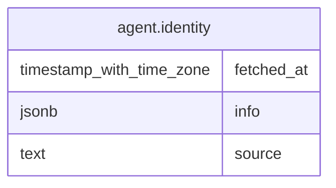

# agent.identity

## Description

The newest readable TrueLayer /info answer per source: source, fetched_at and info, the whole response body as JSON. It is the account holder identity as the bank holds it: name, date of birth, addresses, phone numbers and email addresses. Personal data.

<details>
<summary><strong>Table Definition</strong></summary>

```sql
CREATE VIEW identity AS (
 SELECT DISTINCT ON (source) source,
    fetched_at,
    info
   FROM ( SELECT r.source,
            r.fetched_at,
            r.seq,
            json_body(r.body) AS info
           FROM api_response r
          WHERE ((r.source ~~ 'truelayer:%'::text) AND (r.endpoint = '/data/v1/info'::text) AND (r.status = 200))
         OFFSET 0) s
  WHERE (info IS NOT NULL)
  ORDER BY source, fetched_at DESC, seq DESC
)
```

</details>

## Columns

| Name | Type | Default | Nullable | Children | Parents | Comment |
| ---- | ---- | ------- | -------- | -------- | ------- | ------- |
| fetched_at | timestamp with time zone |  | true |  |  |  |
| info | jsonb |  | true |  |  |  |
| source | text |  | true |  |  |  |

## Referenced Tables

| Name | Columns | Comment | Type |
| ---- | ------- | ------- | ---- |
| [raw.api_response](raw.api_response.md) | 10 |  | BASE TABLE |

## Relations



---

> Generated by [tbls](https://github.com/k1LoW/tbls)
