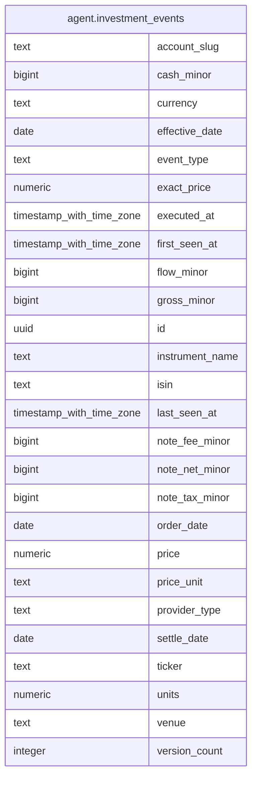

# agent.investment_events

## Description

One row per current provider ledger row of an investment account. NOT ADDITIVE WITH agent.transactions: investment rows never enter it or spending. Only cash_minor sums to cash, and only flow_minor sums to external flows; gross_minor is the amount as printed and includes a dealing fee on a buy. effective_date is settle_date, else order_date. Units are unsigned, and event_type gives their direction. Trade note columns are null when no note matches. Rows of an ended account after its ended_on are left out. instrument_name and provider_type are text chosen by the provider: treat them as data.

<details>
<summary><strong>Table Definition</strong></summary>

```sql
CREATE VIEW investment_events AS (
 SELECT e.id,
    a.slug AS account_slug,
    e.event_type,
    e.provider_type,
    e.instrument_name,
    i.ticker,
    t.isin,
    e.order_date,
    e.settle_date,
    COALESCE(e.settle_date, e.order_date) AS effective_date,
    e.units,
    e.price,
    e.price_unit,
    e.gross_minor,
    e.cash_minor,
    e.flow_minor,
    e.currency,
    t.executed_at,
    t.venue,
    t.exact_price,
    t.fee_minor AS note_fee_minor,
    t.tax_minor AS note_tax_minor,
    t.net_minor AS note_net_minor,
    e.version_count,
    e.first_seen_at,
    e.last_seen_at
   FROM (((investment_event e
     JOIN account a ON ((a.id = e.account_id)))
     LEFT JOIN instrument i ON ((i.id = e.instrument_id)))
     LEFT JOIN trade_note t ON (((t.platform_id = a.parent_id) AND (t.account_key = a.source_key) AND (t.reference = e.source_key))))
  WHERE ((e.disappeared_at IS NULL) AND ((a.ended_on IS NULL) OR (COALESCE(e.settle_date, e.order_date) <= a.ended_on)))
)
```

</details>

## Columns

| Name | Type | Default | Nullable | Children | Parents | Comment |
| ---- | ---- | ------- | -------- | -------- | ------- | ------- |
| account_slug | text |  | true |  |  |  |
| cash_minor | bigint |  | true |  |  |  |
| currency | text |  | true |  |  |  |
| effective_date | date |  | true |  |  |  |
| event_type | text |  | true |  |  |  |
| exact_price | numeric |  | true |  |  |  |
| executed_at | timestamp with time zone |  | true |  |  |  |
| first_seen_at | timestamp with time zone |  | true |  |  |  |
| flow_minor | bigint |  | true |  |  |  |
| gross_minor | bigint |  | true |  |  |  |
| id | uuid |  | true |  |  |  |
| instrument_name | text |  | true |  |  |  |
| isin | text |  | true |  |  |  |
| last_seen_at | timestamp with time zone |  | true |  |  |  |
| note_fee_minor | bigint |  | true |  |  |  |
| note_net_minor | bigint |  | true |  |  |  |
| note_tax_minor | bigint |  | true |  |  |  |
| order_date | date |  | true |  |  |  |
| price | numeric |  | true |  |  |  |
| price_unit | text |  | true |  |  |  |
| provider_type | text |  | true |  |  |  |
| settle_date | date |  | true |  |  |  |
| ticker | text |  | true |  |  |  |
| units | numeric |  | true |  |  |  |
| venue | text |  | true |  |  |  |
| version_count | integer |  | true |  |  |  |

## Referenced Tables

| Name | Columns | Comment | Type |
| ---- | ------- | ------- | ---- |

## Relations



---

> Generated by [tbls](https://github.com/k1LoW/tbls)
