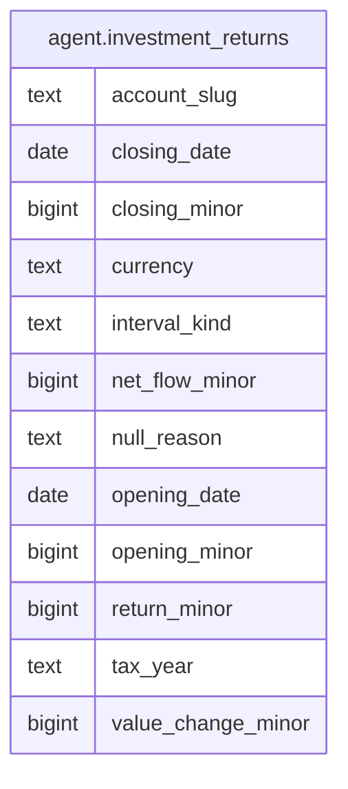

# agent.investment_returns

## Description

One row per investment account and measured interval (opening_date, closing_date], the opening day excluded. interval_kind is statement, since_statement (newest statement closing to newest capture) or no_statement. return_minor = closing - opening - the external flows with an effective date in the interval; it never uses a statement growth figure. It is null with null_reason: statement_missing (no statement, and no opening value is assumed), flows_unverified (a ledger account not reconciled through closing_date, or a statement-only interval that is not exactly one winning statement that passed its check) or flow_unsettled (an external flow has order_date <= boundary < settle_date at either end). net_flow_minor is null whenever return_minor is. value_change_minor is shown whenever both values are known. tax_year (such as 2030-31) is set only on an interval of exactly one tax year, 6 April to 5 April. Sibling transfers are flows of each account and cancel when an account's children are added up.

<details>
<summary><strong>Table Definition</strong></summary>

```sql
CREATE VIEW investment_returns AS (
 WITH child AS (
         SELECT a.id,
            a.slug,
            a.currency,
            a.ended_on,
            r.method,
            r.reconciled_through,
            ((r.last_check_ok IS TRUE) AND (r.break_count = 0)) AS reconciled
           FROM (account a
             JOIN reconciliation r ON ((r.account_id = a.id)))
          WHERE ((a.source ~~ 'investment:%'::text) AND (a.parent_id IS NOT NULL))
        ), stmt AS (
         SELECT s.account_id,
            s.period_start,
            s.period_end,
            s.opening_minor,
            s.closing_minor,
            s.paid_in_minor,
            lag(s.period_end) OVER w AS previous_end,
            lag(s.closing_minor) OVER w AS previous_closing,
            row_number() OVER (PARTITION BY s.account_id ORDER BY s.period_start DESC) AS newest_first
           FROM (pension_statement s
             JOIN child c ON ((c.id = s.account_id)))
          WHERE (s.is_winner AND ((c.ended_on IS NULL) OR (s.period_end <= c.ended_on)))
          WINDOW w AS (PARTITION BY s.account_id ORDER BY s.period_start)
        ), checked AS (
         SELECT st.account_id,
            st.period_start,
            st.period_end,
            st.opening_minor,
            st.closing_minor,
            st.paid_in_minor,
            st.previous_end,
            st.previous_closing,
            st.newest_first,
            ((st.paid_in_minor = COALESCE(p.paid_in, (0)::bigint)) AND ((st.previous_end IS NULL) OR ((st.previous_end + 1) <> st.period_start) OR (st.opening_minor = st.previous_closing))) AS passed
           FROM (stmt st
             CROSS JOIN LATERAL ( SELECT (sum(e.flow_minor))::bigint AS paid_in
                   FROM investment_event e
                  WHERE ((e.account_id = st.account_id) AND (e.event_type = 'contribution'::text) AND (e.disappeared_at IS NULL) AND ((COALESCE(e.settle_date, e.order_date) >= st.period_start) AND (COALESCE(e.settle_date, e.order_date) <= st.period_end)))) p)
        ), latest AS (
         SELECT DISTINCT ON (v.account_id) v.account_id,
            v.as_of,
            v.total_minor
           FROM (valuation v
             JOIN child c ON ((c.id = v.account_id)))
          WHERE ((c.ended_on IS NULL) OR (v.as_of <= c.ended_on))
          ORDER BY v.account_id, v.as_of DESC, v.captured_at DESC, v.raw_seq DESC
        ), measured AS (
         SELECT s.account_id,
            'statement'::text AS interval_kind,
            (s.period_start - 1) AS opening_date,
            s.period_end AS closing_date,
            s.opening_minor,
            s.closing_minor,
            s.passed AS statement_passed
           FROM checked s
        UNION ALL
         SELECT s.account_id,
            'since_statement'::text,
            s.period_end,
            l.as_of,
            s.closing_minor,
            l.total_minor,
            false
           FROM (checked s
             JOIN latest l ON (((l.account_id = s.account_id) AND (l.as_of > s.period_end))))
          WHERE (s.newest_first = 1)
        UNION ALL
         SELECT c.id,
            'no_statement'::text,
            NULL::date AS date,
            l.as_of,
            NULL::bigint AS int8,
            l.total_minor,
            false
           FROM (child c
             LEFT JOIN latest l ON ((l.account_id = c.id)))
          WHERE (NOT (EXISTS ( SELECT 1
                   FROM checked s
                  WHERE (s.account_id = c.id))))
        ), judged AS (
         SELECT m.interval_kind,
            m.opening_date,
            m.closing_date,
            m.opening_minor,
            m.closing_minor,
            c.slug,
            c.currency,
            f.net_flow,
                CASE
                    WHEN (m.interval_kind = 'no_statement'::text) THEN 'statement_missing'::text
                    WHEN (NOT
                    CASE c.method
                        WHEN 'holdings_replay'::text THEN (c.reconciled AND COALESCE((m.closing_date <= c.reconciled_through), false))
                        WHEN 'statement_flows'::text THEN ((m.interval_kind = 'statement'::text) AND m.statement_passed)
                        ELSE false
                    END) THEN 'flows_unverified'::text
                    WHEN f.unsettled THEN 'flow_unsettled'::text
                    ELSE NULL::text
                END AS null_reason
           FROM ((measured m
             JOIN child c ON ((c.id = m.account_id)))
             CROSS JOIN LATERAL ( SELECT (COALESCE(sum(e.flow_minor) FILTER (WHERE ((COALESCE(e.settle_date, e.order_date) > m.opening_date) AND (COALESCE(e.settle_date, e.order_date) <= m.closing_date))), (0)::numeric))::bigint AS net_flow,
                    COALESCE(bool_or(((e.flow_minor <> 0) AND (e.settle_date IS NOT NULL) AND (((e.order_date <= m.opening_date) AND (m.opening_date < e.settle_date)) OR ((e.order_date <= m.closing_date) AND (m.closing_date < e.settle_date))))), false) AS unsettled
                   FROM investment_event e
                  WHERE ((e.account_id = m.account_id) AND (e.disappeared_at IS NULL))) f)
        )
 SELECT slug AS account_slug,
    interval_kind,
    opening_date,
    closing_date,
    opening_minor,
    closing_minor,
    (closing_minor - opening_minor) AS value_change_minor,
        CASE
            WHEN (null_reason IS NULL) THEN net_flow
            ELSE NULL::bigint
        END AS net_flow_minor,
        CASE
            WHEN (null_reason IS NULL) THEN ((closing_minor - opening_minor) - net_flow)
            ELSE NULL::bigint
        END AS return_minor,
    null_reason,
        CASE
            WHEN ((opening_date = make_date((EXTRACT(year FROM opening_date))::integer, 4, 5)) AND (closing_date = make_date(((EXTRACT(year FROM opening_date))::integer + 1), 4, 5))) THEN ((((EXTRACT(year FROM opening_date))::integer)::text || '-'::text) || lpad(((((EXTRACT(year FROM opening_date))::integer + 1) % 100))::text, 2, '0'::text))
            ELSE NULL::text
        END AS tax_year,
    currency
   FROM judged j
)
```

</details>

## Columns

| Name | Type | Default | Nullable | Children | Parents | Comment |
| ---- | ---- | ------- | -------- | -------- | ------- | ------- |
| account_slug | text |  | true |  |  |  |
| closing_date | date |  | true |  |  |  |
| closing_minor | bigint |  | true |  |  |  |
| currency | text |  | true |  |  |  |
| interval_kind | text |  | true |  |  |  |
| net_flow_minor | bigint |  | true |  |  |  |
| null_reason | text |  | true |  |  |  |
| opening_date | date |  | true |  |  |  |
| opening_minor | bigint |  | true |  |  |  |
| return_minor | bigint |  | true |  |  |  |
| tax_year | text |  | true |  |  |  |
| value_change_minor | bigint |  | true |  |  |  |

## Referenced Tables

| Name | Columns | Comment | Type |
| ---- | ------- | ------- | ---- |

## Relations



---

> Generated by [tbls](https://github.com/k1LoW/tbls)
