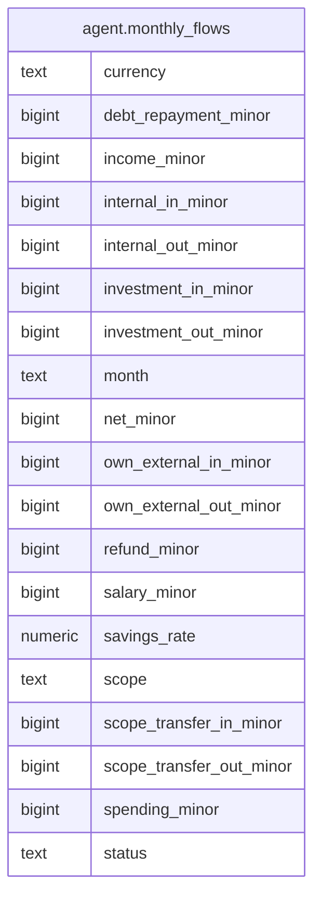

# agent.monthly_flows

## Description

One row per month (YYYY-MM of txn_date), account scope, currency and status (settled or pending: pending rows are kept apart, so readers wanting settled figures filter on status = 'settled'), over agent.cash_flows. Amounts are pence. Class settings respect direction, so income, refund, spending and debt_repayment each hold one sign and every column is a plain sum. income_minor is class income and salary_minor the part from payees with an employer setting; refund_minor is class refund; spending_minor is class spending and debt_repayment_minor class debt_repayment, both as positive numbers; the _out and _in columns split classes investment, own_external, scope_transfer and internal by sign (both positive). net_minor is the signed sum of every class except internal and scope_transfer. savings_rate is (income - (spending - refund) - debt_repayment) / income, rounded to four places, null when income is 0. Internal and scope_transfer legs between held accounts cancel when both legs are held and in the same month.

<details>
<summary><strong>Table Definition</strong></summary>

```sql
CREATE VIEW monthly_flows AS (
 SELECT to_char((txn_date)::timestamp with time zone, 'YYYY-MM'::text) AS month,
    account_scope AS scope,
    currency,
    status,
    (COALESCE(sum(amount_minor) FILTER (WHERE (flow_class = 'income'::text)), (0)::numeric))::bigint AS income_minor,
    (COALESCE(sum(amount_minor) FILTER (WHERE ((flow_class = 'income'::text) AND (employer IS TRUE))), (0)::numeric))::bigint AS salary_minor,
    (COALESCE(sum(amount_minor) FILTER (WHERE (flow_class = 'refund'::text)), (0)::numeric))::bigint AS refund_minor,
    (COALESCE(sum((- amount_minor)) FILTER (WHERE (flow_class = 'spending'::text)), (0)::numeric))::bigint AS spending_minor,
    (COALESCE(sum((- amount_minor)) FILTER (WHERE (flow_class = 'debt_repayment'::text)), (0)::numeric))::bigint AS debt_repayment_minor,
    (COALESCE(sum((- amount_minor)) FILTER (WHERE ((flow_class = 'investment'::text) AND (amount_minor < 0))), (0)::numeric))::bigint AS investment_out_minor,
    (COALESCE(sum(amount_minor) FILTER (WHERE ((flow_class = 'investment'::text) AND (amount_minor > 0))), (0)::numeric))::bigint AS investment_in_minor,
    (COALESCE(sum((- amount_minor)) FILTER (WHERE ((flow_class = 'own_external'::text) AND (amount_minor < 0))), (0)::numeric))::bigint AS own_external_out_minor,
    (COALESCE(sum(amount_minor) FILTER (WHERE ((flow_class = 'own_external'::text) AND (amount_minor > 0))), (0)::numeric))::bigint AS own_external_in_minor,
    (COALESCE(sum((- amount_minor)) FILTER (WHERE ((flow_class = 'scope_transfer'::text) AND (amount_minor < 0))), (0)::numeric))::bigint AS scope_transfer_out_minor,
    (COALESCE(sum(amount_minor) FILTER (WHERE ((flow_class = 'scope_transfer'::text) AND (amount_minor > 0))), (0)::numeric))::bigint AS scope_transfer_in_minor,
    (COALESCE(sum((- amount_minor)) FILTER (WHERE ((flow_class = 'internal'::text) AND (amount_minor < 0))), (0)::numeric))::bigint AS internal_out_minor,
    (COALESCE(sum(amount_minor) FILTER (WHERE ((flow_class = 'internal'::text) AND (amount_minor > 0))), (0)::numeric))::bigint AS internal_in_minor,
    (COALESCE(sum(amount_minor) FILTER (WHERE (flow_class <> ALL (ARRAY['internal'::text, 'scope_transfer'::text]))), (0)::numeric))::bigint AS net_minor,
        CASE
            WHEN (sum(amount_minor) FILTER (WHERE (flow_class = 'income'::text)) > (0)::numeric) THEN round((((sum(amount_minor) FILTER (WHERE (flow_class = 'income'::text)) - (COALESCE(sum((- amount_minor)) FILTER (WHERE (flow_class = 'spending'::text)), (0)::numeric) - COALESCE(sum(amount_minor) FILTER (WHERE (flow_class = 'refund'::text)), (0)::numeric))) - COALESCE(sum((- amount_minor)) FILTER (WHERE (flow_class = 'debt_repayment'::text)), (0)::numeric)) / sum(amount_minor) FILTER (WHERE (flow_class = 'income'::text))), 4)
            ELSE NULL::numeric
        END AS savings_rate
   FROM cash_flows c
  GROUP BY (to_char((txn_date)::timestamp with time zone, 'YYYY-MM'::text)), account_scope, currency, status
)
```

</details>

## Columns

| Name | Type | Default | Nullable | Children | Parents | Comment |
| ---- | ---- | ------- | -------- | -------- | ------- | ------- |
| currency | text |  | true |  |  |  |
| debt_repayment_minor | bigint |  | true |  |  |  |
| income_minor | bigint |  | true |  |  |  |
| internal_in_minor | bigint |  | true |  |  |  |
| internal_out_minor | bigint |  | true |  |  |  |
| investment_in_minor | bigint |  | true |  |  |  |
| investment_out_minor | bigint |  | true |  |  |  |
| month | text |  | true |  |  |  |
| net_minor | bigint |  | true |  |  |  |
| own_external_in_minor | bigint |  | true |  |  |  |
| own_external_out_minor | bigint |  | true |  |  |  |
| refund_minor | bigint |  | true |  |  |  |
| salary_minor | bigint |  | true |  |  |  |
| savings_rate | numeric |  | true |  |  |  |
| scope | text |  | true |  |  |  |
| scope_transfer_in_minor | bigint |  | true |  |  |  |
| scope_transfer_out_minor | bigint |  | true |  |  |  |
| spending_minor | bigint |  | true |  |  |  |
| status | text |  | true |  |  |  |

## Referenced Tables

| Name | Columns | Comment | Type |
| ---- | ------- | ------- | ---- |

## Relations



---

> Generated by [tbls](https://github.com/k1LoW/tbls)
