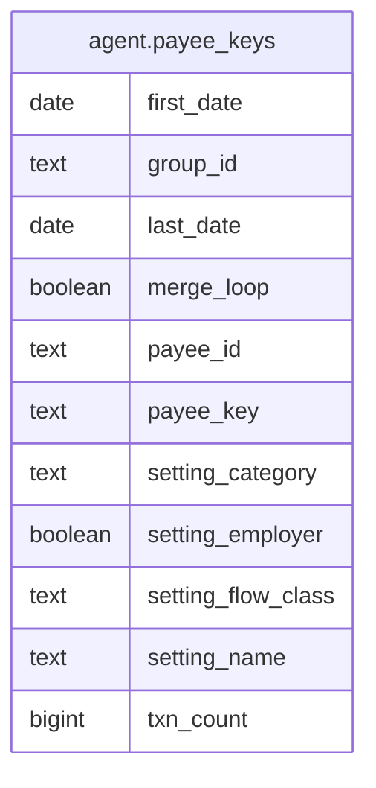

# agent.payee_keys

## Description

How payee keys resolve to payees: one row per payee key that has a transaction that is not declined, or that an operator payee rule names (txn_count 0 then). payee_id is the canonical key. Rules: keys are mg:<merchant group id>, mu:<Monzo user id>, n:<normalised name> or x:<scheme>. A Monzo user id that starts with anonuser_ is not an identity (Monzo makes a new one for each payment from a counterparty outside Monzo), so such a transaction is keyed by its counterparty name (n:) like one without a user id. Two mg: keys are one automatic group when the most frequent normalised merchant name of each (ties by the lowest name) is the same; mu:, n: and x: keys never merge automatically. A key with an operator separate setting leaves its group. A group is identified by its member with the earliest first transaction, ties by the lowest key. An operator merge on any member moves the whole group into the payee its target key belongs to; when members carry different merges the highest entry_seq wins. Merge targets are followed at most ten steps; a loop or a longer chain leaves the group unmerged and sets merge_loop. setting_name, setting_flow_class, setting_employer and setting_category are the payee's operator settings, collected from every key of the payee, per setting the non-null value with the highest entry_seq. A rule stored against an n: key resolves through normalise_payee_name(name_sample), so it follows the normaliser. group_id is the identity of the key's own group.

<details>
<summary><strong>Table Definition</strong></summary>

```sql
CREATE VIEW payee_keys AS (
 WITH RECURSIVE txn AS MATERIALIZED (
         SELECT t.txn_date,
            NULLIF(((t.detail -> 'merchant'::text) ->> 'group_id'::text), ''::text) AS mgid,
                CASE
                    WHEN (((t.detail -> 'counterparty'::text) ->> 'user_id'::text) ~~ 'anonuser\_%'::text) THEN NULL::text
                    ELSE NULLIF(((t.detail -> 'counterparty'::text) ->> 'user_id'::text), ''::text)
                END AS muid,
            COALESCE(NULLIF(t.counterparty, ''::text), NULLIF(t.description, ''::text)) AS key_name,
            COALESCE(NULLIF(t.merchant_name, ''::text), NULLIF(((t.detail -> 'merchant'::text) ->> 'name'::text), ''::text)) AS mname,
            COALESCE(NULLIF(t.scheme, ''::text), 'unknown'::text) AS scheme
           FROM transactions t
          WHERE (t.status <> 'declined'::text)
        ), nn AS MATERIALIZED (
         SELECT d.n,
            normalise_payee_name(d.n) AS nm
           FROM ( SELECT txn.key_name AS n
                   FROM txn
                  WHERE ((txn.key_name IS NOT NULL) AND (txn.mgid IS NULL) AND (txn.muid IS NULL))
                UNION
                 SELECT txn.mname
                   FROM txn
                  WHERE ((txn.mgid IS NOT NULL) AND (txn.mname IS NOT NULL))) d
        ), keyed AS (
         SELECT x.txn_date,
            x.mgid,
                CASE
                    WHEN (x.mgid IS NOT NULL) THEN ('mg:'::text || x.mgid)
                    WHEN (x.muid IS NOT NULL) THEN ('mu:'::text || x.muid)
                    WHEN (k.nm IS NOT NULL) THEN ('n:'::text || k.nm)
                    ELSE ('x:'::text || x.scheme)
                END AS key,
            m.nm AS mg_nm
           FROM ((txn x
             LEFT JOIN nn k ON (((x.mgid IS NULL) AND (x.muid IS NULL) AND (k.n = x.key_name))))
             LEFT JOIN nn m ON (((x.mgid IS NOT NULL) AND (m.n = x.mname))))
        ), ks AS (
         SELECT keyed.key,
            min(keyed.txn_date) AS first_date,
            max(keyed.txn_date) AS last_date,
            count(*) AS txn_count
           FROM keyed
          GROUP BY keyed.key
        ), mgn AS (
         SELECT DISTINCT ON (x.key) x.key,
            x.mg_nm AS nm
           FROM ( SELECT keyed.key,
                    keyed.mg_nm,
                    count(*) AS c
                   FROM keyed
                  WHERE ((keyed.mgid IS NOT NULL) AND (keyed.mg_nm IS NOT NULL))
                  GROUP BY keyed.key, keyed.mg_nm) x
          ORDER BY x.key, x.c DESC, x.mg_nm
        ), alias_r AS (
         SELECT r.k,
            bool_or(r.separate) AS separate,
            (array_agg(r.into_key ORDER BY r.entry_seq DESC) FILTER (WHERE (r.into_key IS NOT NULL)))[1] AS into_key,
            max(r.entry_seq) AS entry_seq
           FROM ( SELECT
                        CASE
                            WHEN ((a.payee_key ~~ 'n:%'::text) AND (a.name_sample IS NOT NULL)) THEN COALESCE(('n:'::text || normalise_payee_name(a.name_sample)), a.payee_key)
                            ELSE a.payee_key
                        END AS k,
                    a.separate,
                    a.into_key,
                    a.entry_seq
                   FROM payee_alias a) r
          GROUP BY r.k
        ), setting_r AS (
         SELECT
                CASE
                    WHEN ((s.payee_key ~~ 'n:%'::text) AND (s.name_sample IS NOT NULL)) THEN COALESCE(('n:'::text || normalise_payee_name(s.name_sample)), s.payee_key)
                    ELSE s.payee_key
                END AS k,
            s.name,
            s.flow_class,
            s.employer,
            s.category,
            s.entry_seq
           FROM payee_setting s
        ), node AS (
         SELECT ks.key,
            ks.first_date,
            ks.last_date,
            ks.txn_count
           FROM ks
        UNION ALL
         SELECT r.k,
            NULL::date AS date,
            NULL::date AS date,
            (0)::bigint AS int8
           FROM ( SELECT alias_r.k
                   FROM alias_r
                UNION
                 SELECT setting_r.k
                   FROM setting_r) r
          WHERE (NOT (EXISTS ( SELECT 1
                   FROM ks
                  WHERE (ks.key = r.k))))
        ), node_g AS (
         SELECT n.key,
            n.first_date,
            n.last_date,
            n.txn_count,
                CASE
                    WHEN COALESCE(a.separate, false) THEN n.key
                    WHEN (mg.nm IS NOT NULL) THEN ('g:'::text || mg.nm)
                    ELSE n.key
                END AS grp
           FROM ((node n
             LEFT JOIN alias_r a ON ((a.k = n.key)))
             LEFT JOIN mgn mg ON ((mg.key = n.key)))
        ), ident AS (
         SELECT DISTINCT ON (node_g.grp) node_g.grp,
            node_g.key AS identity
           FROM node_g
          ORDER BY node_g.grp, node_g.first_date, node_g.key
        ), gm AS (
         SELECT DISTINCT ON (n.grp) n.grp,
            a.into_key
           FROM (node_g n
             JOIN alias_r a ON ((a.k = n.key)))
          WHERE (a.into_key IS NOT NULL)
          ORDER BY n.grp, a.entry_seq DESC, n.key
        ), g AS (
         SELECT i.grp,
            i.identity,
                CASE
                    WHEN (COALESCE(tg.grp, gm.into_key) <> i.grp) THEN COALESCE(tg.grp, gm.into_key)
                    ELSE NULL::text
                END AS tgt
           FROM ((ident i
             LEFT JOIN gm ON ((gm.grp = i.grp)))
             LEFT JOIN node_g tg ON ((tg.key = gm.into_key)))
        ), walk(org, cur, steps, path) AS (
         SELECT g.grp,
            g.grp,
            0 AS "?column?",
            ARRAY[g.grp] AS "array"
           FROM g
          WHERE (g.tgt IS NOT NULL)
        UNION ALL
         SELECT w.org,
            g.tgt,
            (w.steps + 1),
            (w.path || g.tgt)
           FROM (walk w
             JOIN g ON ((g.grp = w.cur)))
          WHERE ((g.tgt IS NOT NULL) AND (w.steps < 10) AND (g.tgt <> ALL (w.path)))
        ), res AS (
         SELECT DISTINCT ON (w.org) w.org AS grp,
            w.cur
           FROM walk w
          ORDER BY w.org, w.steps DESC
        ), canon AS (
         SELECT g.grp,
            g.identity AS group_id,
                CASE
                    WHEN ((r.grp IS NULL) OR (e.tgt IS NOT NULL)) THEN g.identity
                    ELSE COALESCE(e.identity, r.cur)
                END AS payee_id,
            ((r.grp IS NOT NULL) AND (e.tgt IS NOT NULL)) AS merge_loop
           FROM ((g
             LEFT JOIN res r ON ((r.grp = g.grp)))
             LEFT JOIN g e ON ((e.grp = r.cur)))
        ), kc AS (
         SELECT ng.key,
            ng.txn_count,
            ng.first_date,
            ng.last_date,
            c.group_id,
            c.payee_id,
            c.merge_loop
           FROM (node_g ng
             JOIN canon c ON ((c.grp = ng.grp)))
        ), sr AS (
         SELECT kc_1.payee_id AS pid,
            s.k,
            s.name,
            s.flow_class,
            s.employer,
            s.category,
            s.entry_seq
           FROM (setting_r s
             JOIN kc kc_1 ON ((kc_1.key = s.k)))
        ), s_name AS (
         SELECT DISTINCT ON (sr.pid) sr.pid,
            sr.name
           FROM sr
          WHERE (sr.name IS NOT NULL)
          ORDER BY sr.pid, sr.entry_seq DESC, sr.k
        ), s_class AS (
         SELECT DISTINCT ON (sr.pid) sr.pid,
            sr.flow_class,
            sr.employer
           FROM sr
          WHERE (sr.flow_class IS NOT NULL)
          ORDER BY sr.pid, sr.entry_seq DESC, sr.k
        ), s_cat AS (
         SELECT DISTINCT ON (sr.pid) sr.pid,
            sr.category
           FROM sr
          WHERE (sr.category IS NOT NULL)
          ORDER BY sr.pid, sr.entry_seq DESC, sr.k
        )
 SELECT kc.key AS payee_key,
    kc.payee_id,
    kc.group_id,
    kc.txn_count,
    kc.first_date,
    kc.last_date,
    kc.merge_loop,
    sn.name AS setting_name,
    sc.flow_class AS setting_flow_class,
    sc.employer AS setting_employer,
    sy.category AS setting_category
   FROM (((kc
     LEFT JOIN s_name sn ON ((sn.pid = kc.payee_id)))
     LEFT JOIN s_class sc ON ((sc.pid = kc.payee_id)))
     LEFT JOIN s_cat sy ON ((sy.pid = kc.payee_id)))
)
```

</details>

## Columns

| Name | Type | Default | Nullable | Children | Parents | Comment |
| ---- | ---- | ------- | -------- | -------- | ------- | ------- |
| first_date | date |  | true |  |  |  |
| group_id | text |  | true |  |  |  |
| last_date | date |  | true |  |  |  |
| merge_loop | boolean |  | true |  |  |  |
| payee_id | text |  | true |  |  |  |
| payee_key | text |  | true |  |  |  |
| setting_category | text |  | true |  |  |  |
| setting_employer | boolean |  | true |  |  |  |
| setting_flow_class | text |  | true |  |  |  |
| setting_name | text |  | true |  |  |  |
| txn_count | bigint |  | true |  |  |  |

## Referenced Tables

| Name | Columns | Comment | Type |
| ---- | ------- | ------- | ---- |

## Relations



---

> Generated by [tbls](https://github.com/k1LoW/tbls)
