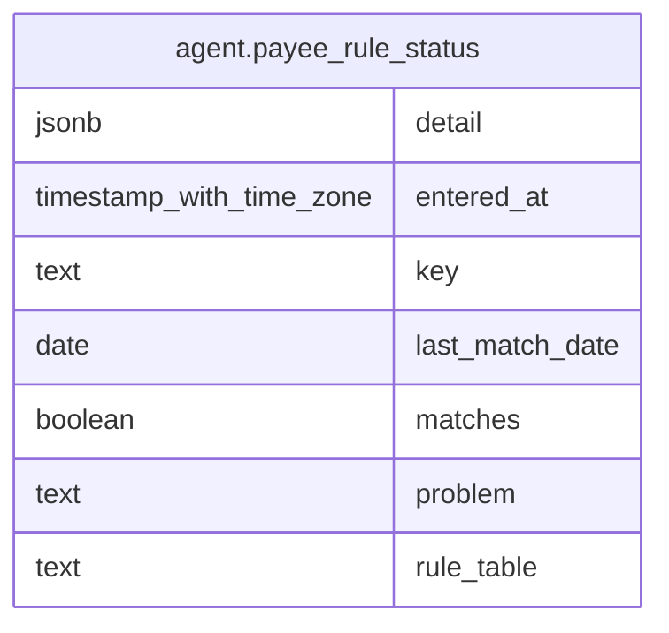

# agent.payee_rule_status

## Description

One row per row of the operator rule tables (rule_table payee_alias, payee_setting, series_setting or category_name), with key (for an n: rule, the key its name_sample normalises to now; for a series rule the series key; for a category name the category), detail (the row's settings as JSON), entered_at, matches, last_match_date and problem. problem is null, no_match (nothing the rule names currently exists) or merge_loop (the merge could not be applied because its chain loops or runs past ten steps). For payee_alias, matches means the key itself has a transaction; for payee_setting, that some transaction belongs to the payee the key resolves to, so a setting on a merge target that has no transactions of its own still matches; for category_name, a transaction carries the category or a payee setting gives it. For series_setting, a series matches while a declared id (dd:, so:, sub:) is on a transaction or an inf: key names an existing transaction; until the recurring payments view exists, an inferred series that has since gained an earlier transaction is not detected.

<details>
<summary><strong>Table Definition</strong></summary>

```sql
CREATE VIEW payee_rule_status AS (
 WITH pk AS MATERIALIZED (
         SELECT payee_keys.payee_key,
            payee_keys.payee_id,
            payee_keys.group_id,
            payee_keys.txn_count,
            payee_keys.first_date,
            payee_keys.last_date,
            payee_keys.merge_loop,
            payee_keys.setting_name,
            payee_keys.setting_flow_class,
            payee_keys.setting_employer,
            payee_keys.setting_category
           FROM payee_keys
        ), pay AS (
         SELECT pk.payee_id,
            sum(pk.txn_count) AS n,
            max(pk.last_date) AS last_date
           FROM pk
          GROUP BY pk.payee_id
        ), declared AS (
         SELECT d.key,
            max(d.txn_date) AS last_date
           FROM (( SELECT k.key,
                    t.txn_date
                   FROM (transactions t
                     CROSS JOIN LATERAL unnest(ARRAY[('dd:'::text || ((t.detail -> 'metadata'::text) ->> 'bacs_direct_debit_instruction_id'::text)), ('so:'::text || ((t.detail -> 'metadata'::text) ->> 'series_id'::text)), ('sub:'::text || ((t.detail -> 'metadata'::text) ->> 'subscription_id'::text)), ('inf:'::text || (t.id)::text)]) k(key))
                  WHERE ((t.status <> 'declined'::text) AND (k.key IS NOT NULL))) d
             JOIN series_setting s ON ((s.series_key = d.key)))
          GROUP BY d.key
        ), categories AS (
         SELECT u.category,
            max(u.last_date) AS last_date
           FROM ( SELECT t.category,
                    max(t.txn_date) AS last_date
                   FROM transactions t
                  WHERE ((t.status <> 'declined'::text) AND (t.category IS NOT NULL))
                  GROUP BY t.category
                UNION ALL
                 SELECT pk.setting_category,
                    max(pk.last_date) AS max
                   FROM pk
                  WHERE ((pk.setting_category IS NOT NULL) AND (pk.txn_count > 0))
                  GROUP BY pk.setting_category) u
          GROUP BY u.category
        )
 SELECT 'payee_alias'::text AS rule_table,
    r.k AS key,
    jsonb_strip_nulls(jsonb_build_object('separate', r.separate, 'into_key', r.into_key, 'name_sample', r.name_sample)) AS detail,
    r.entered_at,
    (COALESCE(k.txn_count, (0)::bigint) > 0) AS matches,
    k.last_date AS last_match_date,
        CASE
            WHEN ((r.into_key IS NOT NULL) AND COALESCE(k.merge_loop, false)) THEN 'merge_loop'::text
            WHEN (COALESCE(k.txn_count, (0)::bigint) = 0) THEN 'no_match'::text
            ELSE NULL::text
        END AS problem
   FROM (( SELECT
                CASE
                    WHEN ((a.payee_key ~~ 'n:%'::text) AND (a.name_sample IS NOT NULL)) THEN COALESCE(('n:'::text || normalise_payee_name(a.name_sample)), a.payee_key)
                    ELSE a.payee_key
                END AS k,
            a.separate,
            a.into_key,
            a.name_sample,
            a.entered_at
           FROM payee_alias a) r
     LEFT JOIN pk k ON ((k.payee_key = r.k)))
UNION ALL
 SELECT 'payee_setting'::text AS rule_table,
    r.k AS key,
    jsonb_strip_nulls(jsonb_build_object('name', r.name, 'flow_class', r.flow_class, 'employer', r.employer, 'category', r.category, 'name_sample', r.name_sample)) AS detail,
    r.entered_at,
    (COALESCE(p.n, (0)::numeric) > (0)::numeric) AS matches,
    p.last_date AS last_match_date,
        CASE
            WHEN (COALESCE(p.n, (0)::numeric) = (0)::numeric) THEN 'no_match'::text
            ELSE NULL::text
        END AS problem
   FROM ((( SELECT
                CASE
                    WHEN ((s.payee_key ~~ 'n:%'::text) AND (s.name_sample IS NOT NULL)) THEN COALESCE(('n:'::text || normalise_payee_name(s.name_sample)), s.payee_key)
                    ELSE s.payee_key
                END AS k,
            s.name,
            s.flow_class,
            s.employer,
            s.category,
            s.name_sample,
            s.entered_at
           FROM payee_setting s) r
     LEFT JOIN pk k ON ((k.payee_key = r.k)))
     LEFT JOIN pay p ON ((p.payee_id = k.payee_id)))
UNION ALL
 SELECT 'series_setting'::text AS rule_table,
    s.series_key AS key,
    jsonb_build_object('recurring', s.recurring) AS detail,
    s.entered_at,
    (d.key IS NOT NULL) AS matches,
    d.last_date AS last_match_date,
        CASE
            WHEN (d.key IS NULL) THEN 'no_match'::text
            ELSE NULL::text
        END AS problem
   FROM (series_setting s
     LEFT JOIN declared d ON ((d.key = s.series_key)))
UNION ALL
 SELECT 'category_name'::text AS rule_table,
    n.category AS key,
    jsonb_build_object('name', n.name) AS detail,
    n.entered_at,
    (c.category IS NOT NULL) AS matches,
    c.last_date AS last_match_date,
        CASE
            WHEN (c.category IS NULL) THEN 'no_match'::text
            ELSE NULL::text
        END AS problem
   FROM (category_name n
     LEFT JOIN categories c ON ((c.category = n.category)))
)
```

</details>

## Columns

| Name | Type | Default | Nullable | Children | Parents | Comment |
| ---- | ---- | ------- | -------- | -------- | ------- | ------- |
| detail | jsonb |  | true |  |  |  |
| entered_at | timestamp with time zone |  | true |  |  |  |
| key | text |  | true |  |  |  |
| last_match_date | date |  | true |  |  |  |
| matches | boolean |  | true |  |  |  |
| problem | text |  | true |  |  |  |
| rule_table | text |  | true |  |  |  |

## Referenced Tables

| Name | Columns | Comment | Type |
| ---- | ------- | ------- | ---- |

## Relations



---

> Generated by [tbls](https://github.com/k1LoW/tbls)
