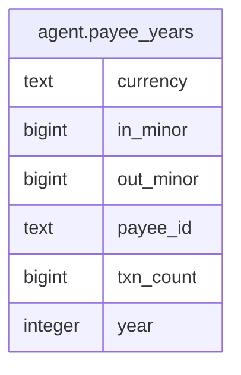

# agent.payee_years

## Description

One row per canonical payee, currency and calendar year (of txn_date), over settled transactions: money out (positive) and money in in pence, and the transaction count. Every flow class is included, so join agent.cash_flows or filter agent.payees by class when only spending is wanted.

<details>
<summary><strong>Table Definition</strong></summary>

```sql
CREATE VIEW payee_years AS (
 SELECT payee_id,
    currency,
    (EXTRACT(year FROM txn_date))::integer AS year,
    (COALESCE(sum((- amount_minor)) FILTER (WHERE (amount_minor < 0)), (0)::numeric))::bigint AS out_minor,
    (COALESCE(sum(amount_minor) FILTER (WHERE (amount_minor > 0)), (0)::numeric))::bigint AS in_minor,
    count(*) AS txn_count
   FROM cash_flows c
  WHERE (status = 'settled'::text)
  GROUP BY payee_id, currency, (EXTRACT(year FROM txn_date))
)
```

</details>

## Columns

| Name | Type | Default | Nullable | Children | Parents | Comment |
| ---- | ---- | ------- | -------- | -------- | ------- | ------- |
| currency | text |  | true |  |  |  |
| in_minor | bigint |  | true |  |  |  |
| out_minor | bigint |  | true |  |  |  |
| payee_id | text |  | true |  |  |  |
| txn_count | bigint |  | true |  |  |  |
| year | integer |  | true |  |  |  |

## Referenced Tables

| Name | Columns | Comment | Type |
| ---- | ------- | ------- | ---- |

## Relations



---

> Generated by [tbls](https://github.com/k1LoW/tbls)
