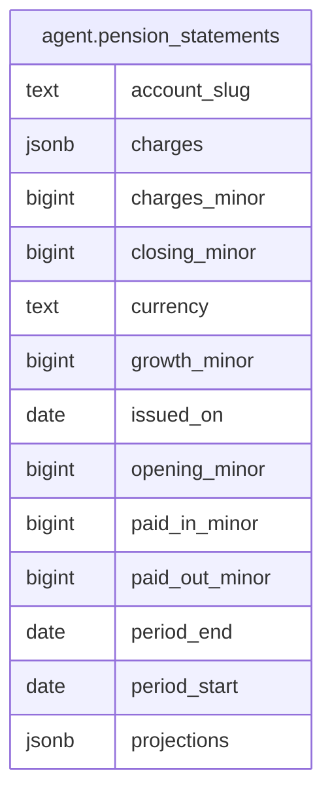

# agent.pension_statements

## Description

One row per winning annual statement, figures as printed, in pence. A statement that lost to an overlapping reissue is left out, and so is an ended account's statement ending after its ended_on. charges_minor null means the charge is unknown for this account and period, never zero; the itemised figures are in charges. growth_minor is before charges at some providers and after them at others, so do not derive a return from it: use agent.investment_returns.

<details>
<summary><strong>Table Definition</strong></summary>

```sql
CREATE VIEW pension_statements AS (
 SELECT a.slug AS account_slug,
    s.period_start,
    s.period_end,
    s.issued_on,
    s.opening_minor,
    s.paid_in_minor,
    s.paid_out_minor,
    s.growth_minor,
    s.charges_minor,
    s.closing_minor,
    s.charges,
    s.projections,
    a.currency
   FROM (pension_statement s
     JOIN account a ON ((a.id = s.account_id)))
  WHERE (s.is_winner AND ((a.ended_on IS NULL) OR (s.period_end <= a.ended_on)))
)
```

</details>

## Columns

| Name | Type | Default | Nullable | Children | Parents | Comment |
| ---- | ---- | ------- | -------- | -------- | ------- | ------- |
| account_slug | text |  | true |  |  |  |
| charges | jsonb |  | true |  |  |  |
| charges_minor | bigint |  | true |  |  |  |
| closing_minor | bigint |  | true |  |  |  |
| currency | text |  | true |  |  |  |
| growth_minor | bigint |  | true |  |  |  |
| issued_on | date |  | true |  |  |  |
| opening_minor | bigint |  | true |  |  |  |
| paid_in_minor | bigint |  | true |  |  |  |
| paid_out_minor | bigint |  | true |  |  |  |
| period_end | date |  | true |  |  |  |
| period_start | date |  | true |  |  |  |
| projections | jsonb |  | true |  |  |  |

## Referenced Tables

| Name | Columns | Comment | Type |
| ---- | ------- | ------- | ---- |

## Relations



---

> Generated by [tbls](https://github.com/k1LoW/tbls)
