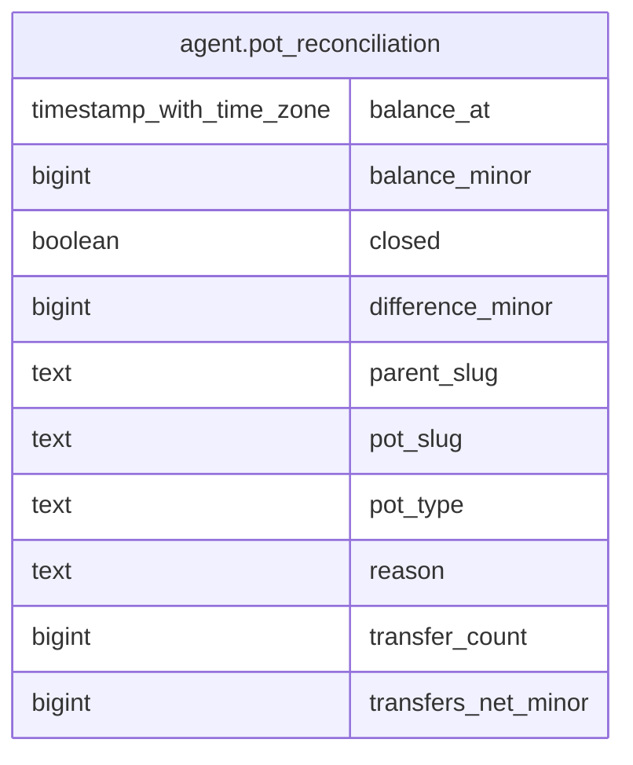

# agent.pot_reconciliation

## Description

One row per pot: its latest balance snapshot (balance_minor, pence), the net of its pot transfers up to that reading (transfers_net_minor), the difference, and reason: matches, interest_not_listed (a savings pot whose balance exceeds its transfers, because Monzo pays interest inside the pot and never lists it) or unexplained. A pot with no balance snapshot has a null balance and reason unexplained.

<details>
<summary><strong>Table Definition</strong></summary>

```sql
CREATE VIEW pot_reconciliation AS (
 WITH latest_balance AS (
         SELECT DISTINCT ON (b.account_id) b.account_id,
            b.balance_minor,
            b.at
           FROM (balance_snapshot b
             JOIN account p ON (((p.id = b.account_id) AND (p.type = 'pot'::text))))
          ORDER BY b.account_id, b.at DESC NULLS LAST, b.raw_seq DESC, b.ordinal DESC
        ), transfers AS (
         SELECT pt.pot_slug,
            (sum(pt.amount_minor))::bigint AS net,
            count(*) AS n
           FROM ((pot_transactions pt
             JOIN account p ON ((p.slug = pt.pot_slug)))
             LEFT JOIN latest_balance b ON ((b.account_id = p.id)))
          WHERE ((b.at IS NULL) OR (pt.created_at IS NULL) OR (pt.created_at <= b.at))
          GROUP BY pt.pot_slug
        ), pots AS (
         SELECT p.slug AS pot_slug,
            par.slug AS parent_slug,
            (ac.detail ->> 'type'::text) AS pot_type,
            p.closed,
            b.balance_minor,
            b.at AS balance_at,
            COALESCE(tr.net, (0)::bigint) AS transfers_net_minor,
            COALESCE(tr.n, (0)::bigint) AS transfer_count
           FROM ((((account p
             LEFT JOIN account par ON ((par.id = p.parent_id)))
             LEFT JOIN accounts ac ON ((ac.slug = p.slug)))
             LEFT JOIN latest_balance b ON ((b.account_id = p.id)))
             LEFT JOIN transfers tr ON ((tr.pot_slug = p.slug)))
          WHERE (p.type = 'pot'::text)
        )
 SELECT pot_slug,
    parent_slug,
    pot_type,
    closed,
    balance_minor,
    balance_at,
    transfers_net_minor,
    transfer_count,
    (balance_minor - transfers_net_minor) AS difference_minor,
        CASE
            WHEN (balance_minor IS NULL) THEN 'unexplained'::text
            WHEN (balance_minor = transfers_net_minor) THEN 'matches'::text
            WHEN ((balance_minor > transfers_net_minor) AND (pot_type = ANY (ARRAY['instant_access'::text, 'flexible_savings'::text]))) THEN 'interest_not_listed'::text
            ELSE 'unexplained'::text
        END AS reason
   FROM pots
)
```

</details>

## Columns

| Name | Type | Default | Nullable | Children | Parents | Comment |
| ---- | ---- | ------- | -------- | -------- | ------- | ------- |
| balance_at | timestamp with time zone |  | true |  |  |  |
| balance_minor | bigint |  | true |  |  |  |
| closed | boolean |  | true |  |  |  |
| difference_minor | bigint |  | true |  |  |  |
| parent_slug | text |  | true |  |  |  |
| pot_slug | text |  | true |  |  |  |
| pot_type | text |  | true |  |  |  |
| reason | text |  | true |  |  |  |
| transfer_count | bigint |  | true |  |  |  |
| transfers_net_minor | bigint |  | true |  |  |  |

## Referenced Tables

| Name | Columns | Comment | Type |
| ---- | ------- | ------- | ---- |

## Relations



---

> Generated by [tbls](https://github.com/k1LoW/tbls)
