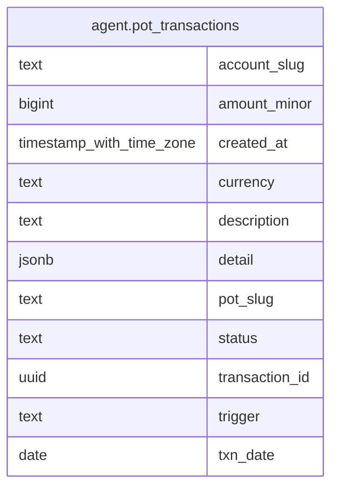

# agent.pot_transactions

## Description

One row per Monzo transaction that moved money into or out of a pot finstore holds, matched on the pot id in its metadata. amount_minor (pence) is from the pot side: positive into the pot, the negation of the amount on the account the transfer was made on. Declined and disappeared transactions are left out; pending ones are kept. These are transfers between your own accounts and pots, not spending.

<details>
<summary><strong>Table Definition</strong></summary>

```sql
CREATE VIEW pot_transactions AS (
 SELECT t.id AS transaction_id,
    pot.slug AS pot_slug,
    a.slug AS account_slug,
    t.txn_date,
    t.created_at,
    (- t.amount_minor) AS amount_minor,
    t.currency,
    t.description,
    ((v.content -> 'metadata'::text) ->> 'trigger'::text) AS trigger,
    t.status,
    v.content AS detail
   FROM (((transaction t
     JOIN account a ON ((a.id = t.account_id)))
     JOIN LATERAL ( SELECT transaction_version.content
           FROM transaction_version
          WHERE ((transaction_version.transaction_id = t.id) AND (transaction_version.content_hash = t.current_hash))
          ORDER BY transaction_version.version_no DESC
         LIMIT 1) v ON (true))
     JOIN account pot ON (((pot.source = 'monzo'::text) AND (pot.type = 'pot'::text) AND (pot.source_key = ((v.content -> 'metadata'::text) ->> 'pot_id'::text)))))
  WHERE ((t.source = 'monzo'::text) AND (t.disappeared_at IS NULL) AND (t.status <> 'declined'::text))
)
```

</details>

## Columns

| Name | Type | Default | Nullable | Children | Parents | Comment |
| ---- | ---- | ------- | -------- | -------- | ------- | ------- |
| account_slug | text |  | true |  |  |  |
| amount_minor | bigint |  | true |  |  |  |
| created_at | timestamp with time zone |  | true |  |  |  |
| currency | text |  | true |  |  |  |
| description | text |  | true |  |  |  |
| detail | jsonb |  | true |  |  |  |
| pot_slug | text |  | true |  |  |  |
| status | text |  | true |  |  |  |
| transaction_id | uuid |  | true |  |  |  |
| trigger | text |  | true |  |  |  |
| txn_date | date |  | true |  |  |  |

## Referenced Tables

| Name | Columns | Comment | Type |
| ---- | ------- | ------- | ---- |

## Relations



---

> Generated by [tbls](https://github.com/k1LoW/tbls)
