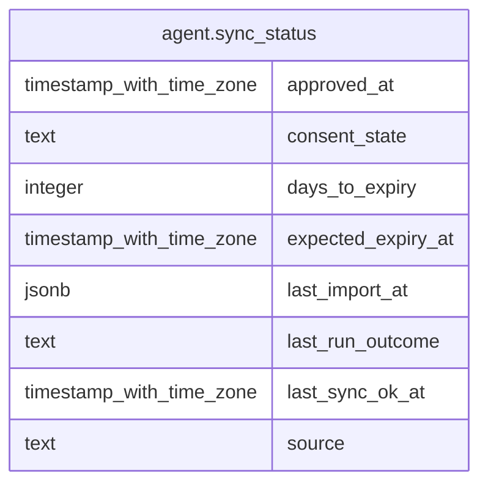

# agent.sync_status

## Description

One row per source seen in consents, runs or accounts: the current consent state and expiry (days_to_expiry), when the last successful sync was, the last finished run outcome, and last_import_at, a JSON object from each file-fed account slug to the time of its latest imported file (null for a source with no file-fed accounts).

<details>
<summary><strong>Table Definition</strong></summary>

```sql
CREATE VIEW sync_status AS (
 WITH sources AS (
         SELECT consent.source
           FROM consent
        UNION
         SELECT run.source
           FROM run
        UNION
         SELECT account.source
           FROM account
        ), cur AS (
         SELECT consent.source,
            consent.state,
            consent.approved_at,
            consent.expected_expiry_at,
            consent.last_sync_ok_at
           FROM consent
          WHERE consent.is_current
        ), last_run AS (
         SELECT DISTINCT ON (run.source) run.source,
            run.outcome
           FROM run
          WHERE (run.finished_at IS NOT NULL)
          ORDER BY run.source, run.finished_at DESC, run.id DESC
        ), imports AS (
         SELECT a.source,
            jsonb_object_agg(a.slug, ( SELECT max(f.imported_at) AS max
                   FROM import_file f
                  WHERE (f.account_slug = COALESCE(platform.slug, a.slug)))) AS obj
           FROM (account a
             LEFT JOIN account platform ON (((a.source ~~ 'investment:%'::text) AND (platform.id = a.parent_id))))
          WHERE (a.feed = 'file'::text)
          GROUP BY a.source
        )
 SELECT s.source,
    c.state AS consent_state,
    c.approved_at,
    c.expected_expiry_at,
        CASE
            WHEN (c.expected_expiry_at IS NULL) THEN NULL::integer
            ELSE (floor((EXTRACT(epoch FROM (c.expected_expiry_at - now())) / (86400)::numeric)))::integer
        END AS days_to_expiry,
    c.last_sync_ok_at,
    lr.outcome AS last_run_outcome,
    i.obj AS last_import_at
   FROM (((sources s
     LEFT JOIN cur c ON ((c.source = s.source)))
     LEFT JOIN last_run lr ON ((lr.source = s.source)))
     LEFT JOIN imports i ON ((i.source = s.source)))
)
```

</details>

## Columns

| Name | Type | Default | Nullable | Children | Parents | Comment |
| ---- | ---- | ------- | -------- | -------- | ------- | ------- |
| approved_at | timestamp with time zone |  | true |  |  |  |
| consent_state | text |  | true |  |  |  |
| days_to_expiry | integer |  | true |  |  |  |
| expected_expiry_at | timestamp with time zone |  | true |  |  |  |
| last_import_at | jsonb |  | true |  |  |  |
| last_run_outcome | text |  | true |  |  |  |
| last_sync_ok_at | timestamp with time zone |  | true |  |  |  |
| source | text |  | true |  |  |  |

## Referenced Tables

| Name | Columns | Comment | Type |
| ---- | ------- | ------- | ---- |
| [raw.import_file](raw.import_file.md) | 8 |  | BASE TABLE |

## Relations



---

> Generated by [tbls](https://github.com/k1LoW/tbls)
