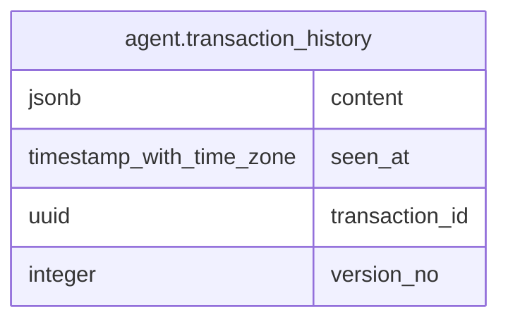

# agent.transaction_history

## Description

Every stored version of each transaction, newest version_no last: transaction_id, version_no, seen_at and content, the source record as it was at that version. A transaction the bank later changes keeps its older versions here. agent.transactions shows the latest version only.

<details>
<summary><strong>Table Definition</strong></summary>

```sql
CREATE VIEW transaction_history AS (
 SELECT transaction_id,
    version_no,
    seen_at,
    content
   FROM transaction_version v
)
```

</details>

## Columns

| Name | Type | Default | Nullable | Children | Parents | Comment |
| ---- | ---- | ------- | -------- | -------- | ------- | ------- |
| content | jsonb |  | true |  |  |  |
| seen_at | timestamp with time zone |  | true |  |  |  |
| transaction_id | uuid |  | true |  |  |  |
| version_no | integer |  | true |  |  |  |

## Referenced Tables

| Name | Columns | Comment | Type |
| ---- | ------- | ------- | ---- |

## Relations



---

> Generated by [tbls](https://github.com/k1LoW/tbls)
