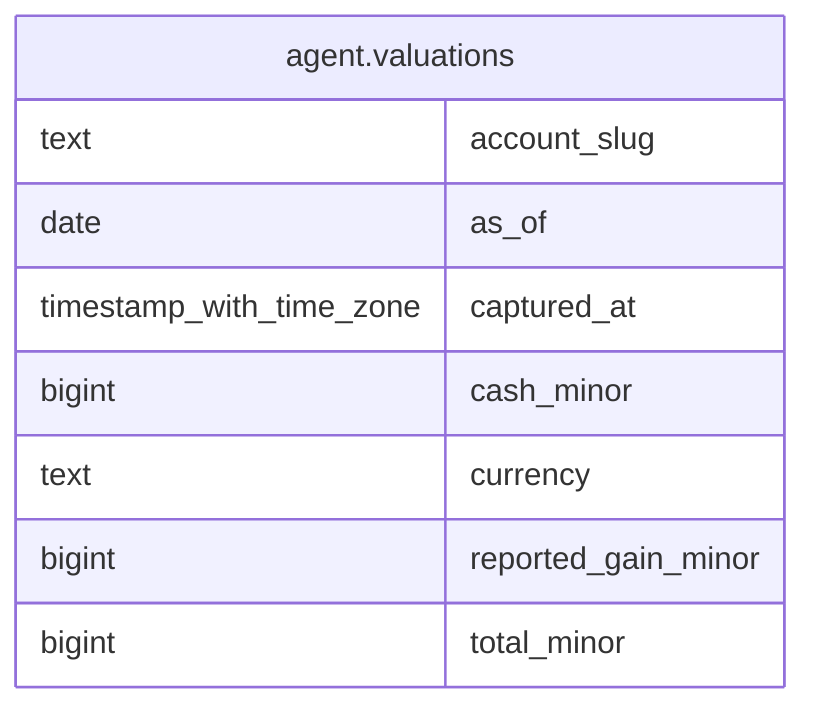

# agent.valuations

## Description

One row per investment account and date, from the latest capture of that date. total_minor and cash_minor are integer minor units (pence) as the provider reported them. Values are not cash balances and do not belong in a sum with agent.balances. A value of 0 is a real value. An ended account's dates after its ended_on are left out.

<details>
<summary><strong>Table Definition</strong></summary>

```sql
CREATE VIEW valuations AS (
 SELECT DISTINCT ON (v.account_id, v.as_of) a.slug AS account_slug,
    v.as_of,
    v.captured_at,
    v.total_minor,
    v.cash_minor,
    v.reported_gain_minor,
    v.currency
   FROM (valuation v
     JOIN account a ON ((a.id = v.account_id)))
  WHERE ((a.ended_on IS NULL) OR (v.as_of <= a.ended_on))
  ORDER BY v.account_id, v.as_of, v.captured_at DESC, v.raw_seq DESC
)
```

</details>

## Columns

| Name | Type | Default | Nullable | Children | Parents | Comment |
| ---- | ---- | ------- | -------- | -------- | ------- | ------- |
| account_slug | text |  | true |  |  |  |
| as_of | date |  | true |  |  |  |
| captured_at | timestamp with time zone |  | true |  |  |  |
| cash_minor | bigint |  | true |  |  |  |
| currency | text |  | true |  |  |  |
| reported_gain_minor | bigint |  | true |  |  |  |
| total_minor | bigint |  | true |  |  |  |

## Referenced Tables

| Name | Columns | Comment | Type |
| ---- | ------- | ------- | ---- |

## Relations



---

> Generated by [tbls](https://github.com/k1LoW/tbls)
