# core.account

## Columns

| Name | Type | Default | Nullable | Children | Parents | Comment |
| ---- | ---- | ------- | -------- | -------- | ------- | ------- |
| bank_ref | text |  | true |  |  |  |
| closed | boolean | false | false |  |  |  |
| currency | text |  | false |  |  |  |
| detail | jsonb |  | true |  |  |  |
| ended_on | date |  | true |  |  |  |
| expects_imports | boolean | false | false |  |  |  |
| feed | text |  | false |  |  |  |
| id | uuid |  | false | [core.balance_snapshot](core.balance_snapshot.md) [core.direct_debit](core.direct_debit.md) [core.fetch_period](core.fetch_period.md) [core.file_gap](core.file_gap.md) [core.holding_check](core.holding_check.md) [core.holding_snapshot](core.holding_snapshot.md) [core.investment_event](core.investment_event.md) [core.investment_import](core.investment_import.md) [core.pending_snapshot](core.pending_snapshot.md) [core.pending_transaction](core.pending_transaction.md) [core.pension_statement](core.pension_statement.md) [core.reconciliation](core.reconciliation.md) [core.standing_order](core.standing_order.md) [core.statement](core.statement.md) [core.trade_note](core.trade_note.md) [core.transaction](core.transaction.md) [core.valuation](core.valuation.md) |  |  |
| name | text |  | false |  |  |  |
| opened_on | date |  | true |  |  |  |
| parent_id | uuid |  | true |  |  |  |
| scope | text |  | true |  |  |  |
| slug | text |  | false |  |  |  |
| source | text |  | false |  |  |  |
| source_key | text |  | false |  |  |  |
| type | text |  | false |  |  |  |

## Constraints

| Name | Type | Definition |
| ---- | ---- | ---------- |
| account_closed_not_null | n | NOT NULL closed |
| account_currency_not_null | n | NOT NULL currency |
| account_expects_imports_not_null | n | NOT NULL expects_imports |
| account_feed_check | CHECK | CHECK ((feed = ANY (ARRAY['api'::text, 'file'::text]))) |
| account_feed_not_null | n | NOT NULL feed |
| account_id_not_null | n | NOT NULL id |
| account_name_not_null | n | NOT NULL name |
| account_pkey | PRIMARY KEY | PRIMARY KEY (id) |
| account_scope_check | CHECK | CHECK ((scope = ANY (ARRAY['personal'::text, 'joint'::text, 'business'::text]))) |
| account_slug_key | UNIQUE | UNIQUE (slug) |
| account_slug_not_null | n | NOT NULL slug |
| account_source_key_not_null | n | NOT NULL source_key |
| account_source_not_null | n | NOT NULL source |
| account_source_source_key_key | UNIQUE | UNIQUE (source, source_key) |
| account_type_not_null | n | NOT NULL type |

## Indexes

| Name | Definition |
| ---- | ---------- |
| account_bank_ref | CREATE INDEX account_bank_ref ON core.account USING btree (bank_ref) |
| account_pkey | CREATE UNIQUE INDEX account_pkey ON core.account USING btree (id) |
| account_slug_key | CREATE UNIQUE INDEX account_slug_key ON core.account USING btree (slug) |
| account_source_source_key_key | CREATE UNIQUE INDEX account_source_source_key_key ON core.account USING btree (source, source_key) |

## Relations

```mermaid
erDiagram

"core.balance_snapshot" }o--|| "core.account" : "FOREIGN KEY (account_id) REFERENCES account(id)"
"core.direct_debit" }o--o| "core.account" : "FOREIGN KEY (account_id) REFERENCES account(id)"
"core.fetch_period" }o--|| "core.account" : "FOREIGN KEY (account_id) REFERENCES account(id)"
"core.file_gap" }o--|| "core.account" : "FOREIGN KEY (account_id) REFERENCES account(id)"
"core.holding_check" }o--|| "core.account" : "FOREIGN KEY (account_id) REFERENCES account(id)"
"core.holding_snapshot" }o--|| "core.account" : "FOREIGN KEY (account_id) REFERENCES account(id)"
"core.investment_event" }o--|| "core.account" : "FOREIGN KEY (account_id) REFERENCES account(id)"
"core.investment_import" }o--|| "core.account" : "FOREIGN KEY (platform_id) REFERENCES account(id)"
"core.pending_snapshot" |o--|| "core.account" : "FOREIGN KEY (account_id) REFERENCES account(id)"
"core.pending_transaction" }o--|| "core.account" : "FOREIGN KEY (account_id) REFERENCES account(id)"
"core.pension_statement" }o--|| "core.account" : "FOREIGN KEY (account_id) REFERENCES account(id)"
"core.reconciliation" |o--|| "core.account" : "FOREIGN KEY (account_id) REFERENCES account(id)"
"core.standing_order" }o--o| "core.account" : "FOREIGN KEY (account_id) REFERENCES account(id)"
"core.statement" }o--|| "core.account" : "FOREIGN KEY (account_id) REFERENCES account(id)"
"core.trade_note" }o--|| "core.account" : "FOREIGN KEY (platform_id) REFERENCES account(id)"
"core.transaction" }o--|| "core.account" : "FOREIGN KEY (account_id) REFERENCES account(id)"
"core.valuation" }o--|| "core.account" : "FOREIGN KEY (account_id) REFERENCES account(id)"

"core.account" {
  text bank_ref
  boolean closed
  text currency
  jsonb detail
  date ended_on
  boolean expects_imports
  text feed
  uuid id
  text name
  date opened_on
  uuid parent_id
  text scope
  text slug
  text source
  text source_key
  text type
}
"core.balance_snapshot" {
  uuid account_id FK
  timestamp_with_time_zone at
  bigint balance_minor
  text currency
  date on_date
  integer ordinal
  bigint raw_seq
  bigint total_balance_minor
}
"core.direct_debit" {
  uuid account_id FK
  text bank_ref
  text currency
  bytea current_hash
  timestamp_with_time_zone disappeared_at
  timestamp_with_time_zone first_seen_at
  uuid id
  timestamp_with_time_zone last_seen_at
  text mandate_key
  text name
  bigint previous_amount_minor
  date previous_date
  text source
  text status
  integer version_count
}
"core.fetch_period" {
  uuid account_id FK
  bigint fetch_id
  timestamp_with_time_zone period_end
  timestamp_with_time_zone period_start
}
"core.file_gap" {
  text accepted_reason
  uuid account_id FK
  date after_date
  date before_date
  bigint diff_minor
  bigint raw_seq
}
"core.holding_check" {
  uuid account_id FK
  date checked_as_of
  numeric difference
  numeric expected_units
  uuid instrument_id FK
  numeric reported_units
}
"core.holding_snapshot" {
  uuid account_id FK
  date as_of
  bigint book_cost_minor
  timestamp_with_time_zone captured_at
  text currency
  uuid instrument_id FK
  text instrument_name
  numeric price
  text price_unit
  bigint raw_seq
  numeric units
  bigint value_minor
}
"core.investment_event" {
  uuid account_id FK
  bigint cash_minor
  text currency
  bytea current_hash
  timestamp_with_time_zone disappeared_at
  text event_type
  timestamp_with_time_zone first_seen_at
  bigint flow_minor
  bigint gross_minor
  uuid id
  uuid instrument_id FK
  text instrument_name
  timestamp_with_time_zone last_seen_at
  date order_date
  numeric price
  text price_unit
  text provider_type
  date settle_date
  text source
  text source_key
  numeric units
  integer version_count
}
"core.investment_import" {
  timestamp_with_time_zone captured_at
  text format
  timestamp_with_time_zone imported_at
  text kind
  uuid platform_id FK
  bigint raw_seq
  integer row_count
}
"core.pending_snapshot" {
  uuid account_id FK
  timestamp_with_time_zone as_of
  bigint raw_seq
  integer row_count
}
"core.pending_transaction" {
  uuid account_id FK
  bigint amount_minor
  jsonb content
  text currency
  text description
  text merchant_name
  text transaction_id
  date txn_date
}
"core.pension_statement" {
  uuid account_id FK
  jsonb charges
  bigint charges_minor
  bigint closing_minor
  bigint growth_minor
  boolean is_winner
  date issued_on
  bigint opening_minor
  bigint paid_in_minor
  bigint paid_out_minor
  date period_end
  date period_start
  jsonb projections
  bigint raw_seq
}
"core.reconciliation" {
  bigint accepted_diff_minor
  uuid account_id FK
  bigint anchor_diff_minor
  date anchor_on
  bigint anchor_raw_seq
  integer break_count
  date failed_on
  text known_exception
  timestamp_with_time_zone last_check_at
  boolean last_check_ok
  bigint last_diff_minor
  timestamp_with_time_zone last_pass_at
  text method
  date reconciled_through
  bigint running_sum_minor
}
"core.standing_order" {
  uuid account_id FK
  text bank_ref
  text currency
  bytea current_hash
  timestamp_with_time_zone disappeared_at
  bigint final_amount_minor
  date final_date
  bigint first_amount_minor
  date first_date
  timestamp_with_time_zone first_seen_at
  text frequency
  uuid id
  timestamp_with_time_zone last_seen_at
  text mandate_key
  bigint next_amount_minor
  date next_date
  text payee
  text reference
  text source
  text status
  integer version_count
}
"core.statement" {
  uuid account_id FK
  bigint closing_minor
  boolean exact_period
  date first_date
  date last_date
  bigint opening_minor
  bigint raw_seq
}
"core.trade_note" {
  text account_key
  numeric exact_price
  timestamp_with_time_zone executed_at
  bigint fee_minor
  bigint gross_minor
  text isin
  bigint net_minor
  uuid platform_id FK
  bigint raw_seq
  text reference
  date settle_date
  bigint tax_minor
  numeric units
  text venue
}
"core.transaction" {
  uuid account_id FK
  bigint amount_minor
  text category
  text counterparty
  timestamp_with_time_zone created_at
  text currency
  bytea current_hash
  text description
  timestamp_with_time_zone disappeared_at
  timestamp_with_time_zone first_seen_at
  uuid id
  timestamp_with_time_zone last_seen_at
  bigint local_amount_minor
  text local_currency
  text merchant_id
  text merchant_name
  text notes
  text scheme
  timestamp_with_time_zone settled_at
  text source
  text source_key
  text status
  date txn_date
  integer version_count
}
"core.valuation" {
  uuid account_id FK
  date as_of
  timestamp_with_time_zone captured_at
  bigint cash_minor
  text currency
  bigint raw_seq
  bigint reported_gain_minor
  bigint total_minor
}
```

---

> Generated by [tbls](https://github.com/k1LoW/tbls)
