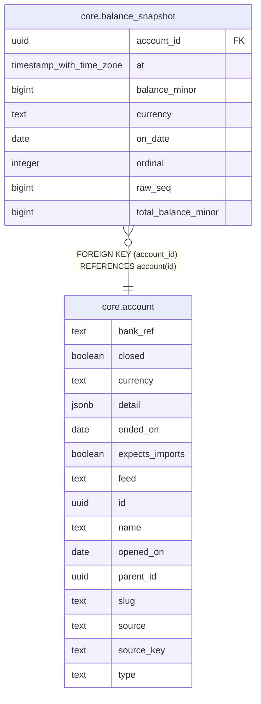

# core.balance_snapshot

## Columns

| Name | Type | Default | Nullable | Children | Parents | Comment |
| ---- | ---- | ------- | -------- | -------- | ------- | ------- |
| account_id | uuid |  | false |  | [core.account](core.account.md) |  |
| at | timestamp with time zone |  | true |  |  |  |
| balance_minor | bigint |  | false |  |  |  |
| currency | text |  | false |  |  |  |
| on_date | date |  | true |  |  |  |
| ordinal | integer |  | false |  |  |  |
| raw_seq | bigint |  | false |  |  |  |
| total_balance_minor | bigint |  | true |  |  |  |

## Constraints

| Name | Type | Definition |
| ---- | ---- | ---------- |
| balance_snapshot_account_id_fkey | FOREIGN KEY | FOREIGN KEY (account_id) REFERENCES account(id) |
| balance_snapshot_account_id_not_null | n | NOT NULL account_id |
| balance_snapshot_balance_minor_not_null | n | NOT NULL balance_minor |
| balance_snapshot_currency_not_null | n | NOT NULL currency |
| balance_snapshot_ordinal_not_null | n | NOT NULL ordinal |
| balance_snapshot_pkey | PRIMARY KEY | PRIMARY KEY (account_id, raw_seq, ordinal) |
| balance_snapshot_raw_seq_not_null | n | NOT NULL raw_seq |

## Indexes

| Name | Definition |
| ---- | ---------- |
| balance_snapshot_pkey | CREATE UNIQUE INDEX balance_snapshot_pkey ON core.balance_snapshot USING btree (account_id, raw_seq, ordinal) |

## Relations

---

> Generated by [tbls](https://github.com/k1LoW/tbls)
