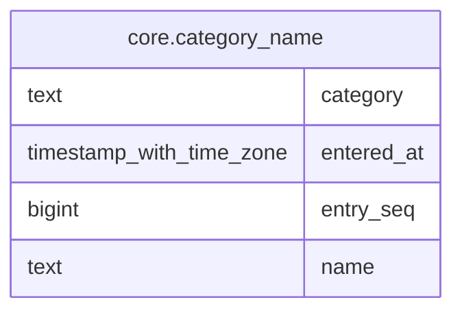

# core.category_name

## Columns

| Name | Type | Default | Nullable | Children | Parents | Comment |
| ---- | ---- | ------- | -------- | -------- | ------- | ------- |
| category | text |  | false |  |  |  |
| entered_at | timestamp with time zone |  | false |  |  |  |
| entry_seq | bigint |  | false |  |  |  |
| name | text |  | false |  |  |  |

## Constraints

| Name | Type | Definition |
| ---- | ---- | ---------- |
| category_name_category_not_null | n | NOT NULL category |
| category_name_entered_at_not_null | n | NOT NULL entered_at |
| category_name_entry_seq_not_null | n | NOT NULL entry_seq |
| category_name_name_not_null | n | NOT NULL name |
| category_name_pkey | PRIMARY KEY | PRIMARY KEY (category) |

## Indexes

| Name | Definition |
| ---- | ---------- |
| category_name_pkey | CREATE UNIQUE INDEX category_name_pkey ON core.category_name USING btree (category) |

## Relations

---

> Generated by [tbls](https://github.com/k1LoW/tbls)
