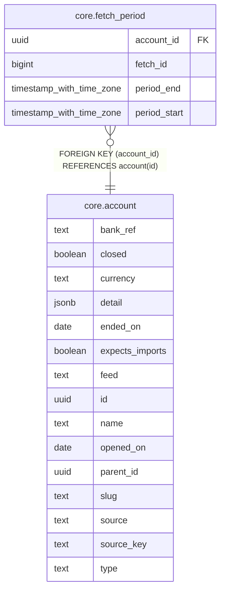

# core.fetch_period

## Columns

| Name | Type | Default | Nullable | Children | Parents | Comment |
| ---- | ---- | ------- | -------- | -------- | ------- | ------- |
| account_id | uuid |  | false |  | [core.account](core.account.md) |  |
| fetch_id | bigint |  | false |  |  |  |
| period_end | timestamp with time zone |  | false |  |  |  |
| period_start | timestamp with time zone |  | false |  |  |  |

## Constraints

| Name | Type | Definition |
| ---- | ---- | ---------- |
| fetch_period_account_id_fkey | FOREIGN KEY | FOREIGN KEY (account_id) REFERENCES account(id) |
| fetch_period_account_id_not_null | n | NOT NULL account_id |
| fetch_period_fetch_id_not_null | n | NOT NULL fetch_id |
| fetch_period_period_end_not_null | n | NOT NULL period_end |
| fetch_period_period_start_not_null | n | NOT NULL period_start |
| fetch_period_pkey | PRIMARY KEY | PRIMARY KEY (fetch_id) |

## Indexes

| Name | Definition |
| ---- | ---------- |
| fetch_period_account | CREATE INDEX fetch_period_account ON core.fetch_period USING btree (account_id) |
| fetch_period_pkey | CREATE UNIQUE INDEX fetch_period_pkey ON core.fetch_period USING btree (fetch_id) |

## Relations

---

> Generated by [tbls](https://github.com/k1LoW/tbls)
