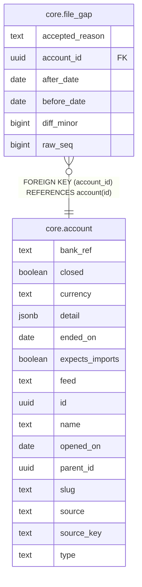

# core.file_gap

## Columns

| Name | Type | Default | Nullable | Children | Parents | Comment |
| ---- | ---- | ------- | -------- | -------- | ------- | ------- |
| accepted_reason | text |  | true |  |  |  |
| account_id | uuid |  | false |  | [core.account](core.account.md) |  |
| after_date | date |  | false |  |  |  |
| before_date | date |  | false |  |  |  |
| diff_minor | bigint |  | false |  |  |  |
| raw_seq | bigint |  | false |  |  |  |

## Constraints

| Name | Type | Definition |
| ---- | ---- | ---------- |
| file_gap_account_id_fkey | FOREIGN KEY | FOREIGN KEY (account_id) REFERENCES account(id) |
| file_gap_account_id_not_null | n | NOT NULL account_id |
| file_gap_after_date_not_null | n | NOT NULL after_date |
| file_gap_before_date_not_null | n | NOT NULL before_date |
| file_gap_diff_minor_not_null | n | NOT NULL diff_minor |
| file_gap_pkey | PRIMARY KEY | PRIMARY KEY (account_id, raw_seq) |
| file_gap_raw_seq_not_null | n | NOT NULL raw_seq |

## Indexes

| Name | Definition |
| ---- | ---------- |
| file_gap_pkey | CREATE UNIQUE INDEX file_gap_pkey ON core.file_gap USING btree (account_id, raw_seq) |

## Relations

---

> Generated by [tbls](https://github.com/k1LoW/tbls)
