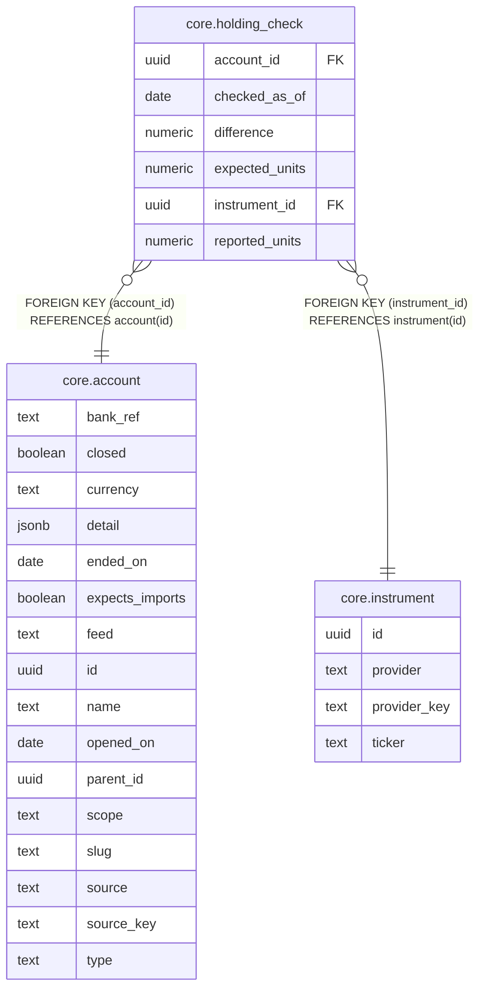

# core.holding_check

## Columns

| Name | Type | Default | Nullable | Children | Parents | Comment |
| ---- | ---- | ------- | -------- | -------- | ------- | ------- |
| account_id | uuid |  | false |  | [core.account](core.account.md) |  |
| checked_as_of | date |  | false |  |  |  |
| difference | numeric |  | false |  |  |  |
| expected_units | numeric |  | false |  |  |  |
| instrument_id | uuid |  | false |  | [core.instrument](core.instrument.md) |  |
| reported_units | numeric |  | false |  |  |  |

## Constraints

| Name | Type | Definition |
| ---- | ---- | ---------- |
| holding_check_account_id_fkey | FOREIGN KEY | FOREIGN KEY (account_id) REFERENCES account(id) |
| holding_check_account_id_not_null | n | NOT NULL account_id |
| holding_check_checked_as_of_not_null | n | NOT NULL checked_as_of |
| holding_check_difference_not_null | n | NOT NULL difference |
| holding_check_expected_units_not_null | n | NOT NULL expected_units |
| holding_check_instrument_id_fkey | FOREIGN KEY | FOREIGN KEY (instrument_id) REFERENCES instrument(id) |
| holding_check_instrument_id_not_null | n | NOT NULL instrument_id |
| holding_check_pkey | PRIMARY KEY | PRIMARY KEY (account_id, instrument_id) |
| holding_check_reported_units_not_null | n | NOT NULL reported_units |

## Indexes

| Name | Definition |
| ---- | ---------- |
| holding_check_pkey | CREATE UNIQUE INDEX holding_check_pkey ON core.holding_check USING btree (account_id, instrument_id) |

## Relations

---

> Generated by [tbls](https://github.com/k1LoW/tbls)
