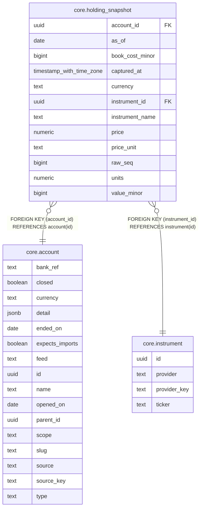

# core.holding_snapshot

## Columns

| Name | Type | Default | Nullable | Children | Parents | Comment |
| ---- | ---- | ------- | -------- | -------- | ------- | ------- |
| account_id | uuid |  | false |  | [core.account](core.account.md) |  |
| as_of | date |  | false |  |  |  |
| book_cost_minor | bigint |  | true |  |  |  |
| captured_at | timestamp with time zone |  | false |  |  |  |
| currency | text |  | false |  |  |  |
| instrument_id | uuid |  | false |  | [core.instrument](core.instrument.md) |  |
| instrument_name | text |  | false |  |  |  |
| price | numeric |  | false |  |  |  |
| price_unit | text |  | false |  |  |  |
| raw_seq | bigint |  | false |  |  |  |
| units | numeric |  | false |  |  |  |
| value_minor | bigint |  | false |  |  |  |

## Constraints

| Name | Type | Definition |
| ---- | ---- | ---------- |
| holding_snapshot_account_id_fkey | FOREIGN KEY | FOREIGN KEY (account_id) REFERENCES account(id) |
| holding_snapshot_account_id_not_null | n | NOT NULL account_id |
| holding_snapshot_as_of_not_null | n | NOT NULL as_of |
| holding_snapshot_captured_at_not_null | n | NOT NULL captured_at |
| holding_snapshot_currency_not_null | n | NOT NULL currency |
| holding_snapshot_instrument_id_fkey | FOREIGN KEY | FOREIGN KEY (instrument_id) REFERENCES instrument(id) |
| holding_snapshot_instrument_id_not_null | n | NOT NULL instrument_id |
| holding_snapshot_instrument_name_not_null | n | NOT NULL instrument_name |
| holding_snapshot_pkey | PRIMARY KEY | PRIMARY KEY (account_id, raw_seq, instrument_id) |
| holding_snapshot_price_not_null | n | NOT NULL price |
| holding_snapshot_price_unit_check | CHECK | CHECK ((price_unit = ANY (ARRAY['GBP'::text, 'GBX'::text]))) |
| holding_snapshot_price_unit_not_null | n | NOT NULL price_unit |
| holding_snapshot_raw_seq_not_null | n | NOT NULL raw_seq |
| holding_snapshot_units_not_null | n | NOT NULL units |
| holding_snapshot_value_minor_not_null | n | NOT NULL value_minor |

## Indexes

| Name | Definition |
| ---- | ---------- |
| holding_snapshot_pkey | CREATE UNIQUE INDEX holding_snapshot_pkey ON core.holding_snapshot USING btree (account_id, raw_seq, instrument_id) |

## Relations

---

> Generated by [tbls](https://github.com/k1LoW/tbls)
