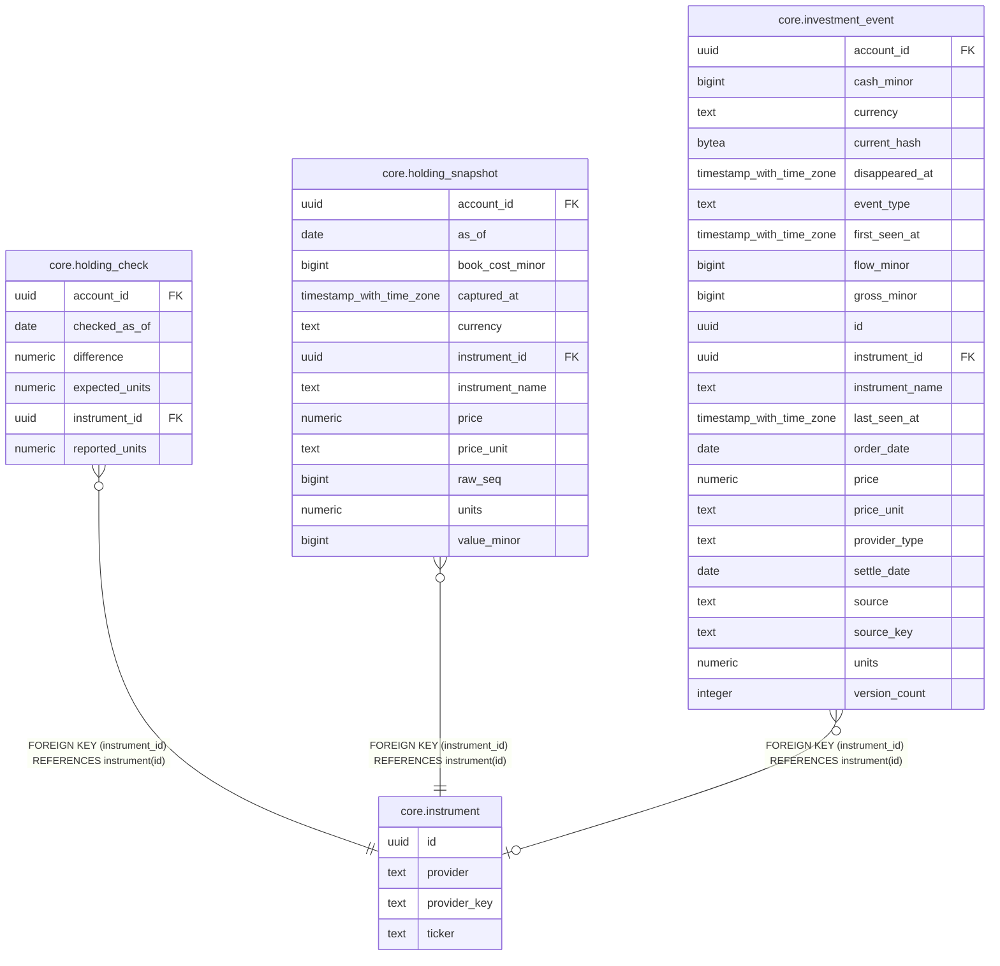

# core.instrument

## Columns

| Name | Type | Default | Nullable | Children | Parents | Comment |
| ---- | ---- | ------- | -------- | -------- | ------- | ------- |
| id | uuid |  | false | [core.holding_check](core.holding_check.md) [core.holding_snapshot](core.holding_snapshot.md) [core.investment_event](core.investment_event.md) |  |  |
| provider | text |  | false |  |  |  |
| provider_key | text |  | false |  |  |  |
| ticker | text |  | true |  |  |  |

## Constraints

| Name | Type | Definition |
| ---- | ---- | ---------- |
| instrument_id_not_null | n | NOT NULL id |
| instrument_pkey | PRIMARY KEY | PRIMARY KEY (id) |
| instrument_provider_key_not_null | n | NOT NULL provider_key |
| instrument_provider_not_null | n | NOT NULL provider |
| instrument_provider_provider_key_key | UNIQUE | UNIQUE (provider, provider_key) |

## Indexes

| Name | Definition |
| ---- | ---------- |
| instrument_pkey | CREATE UNIQUE INDEX instrument_pkey ON core.instrument USING btree (id) |
| instrument_provider_provider_key_key | CREATE UNIQUE INDEX instrument_provider_provider_key_key ON core.instrument USING btree (provider, provider_key) |

## Relations

---

> Generated by [tbls](https://github.com/k1LoW/tbls)
