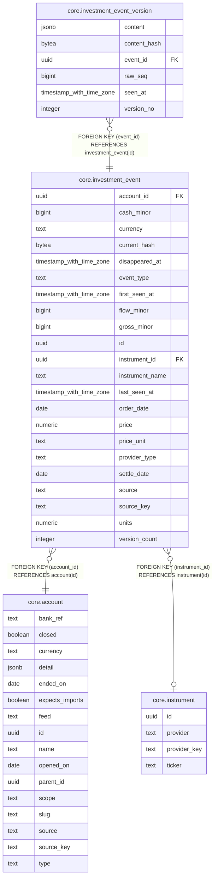

# core.investment_event

## Columns

| Name | Type | Default | Nullable | Children | Parents | Comment |
| ---- | ---- | ------- | -------- | -------- | ------- | ------- |
| account_id | uuid |  | false |  | [core.account](core.account.md) |  |
| cash_minor | bigint |  | false |  |  |  |
| currency | text |  | false |  |  |  |
| current_hash | bytea |  | false |  |  |  |
| disappeared_at | timestamp with time zone |  | true |  |  |  |
| event_type | text |  | false |  |  |  |
| first_seen_at | timestamp with time zone |  | false |  |  |  |
| flow_minor | bigint |  | false |  |  |  |
| gross_minor | bigint |  | false |  |  |  |
| id | uuid |  | false | [core.investment_event_version](core.investment_event_version.md) |  |  |
| instrument_id | uuid |  | true |  | [core.instrument](core.instrument.md) |  |
| instrument_name | text |  | true |  |  |  |
| last_seen_at | timestamp with time zone |  | false |  |  |  |
| order_date | date |  | false |  |  |  |
| price | numeric |  | true |  |  |  |
| price_unit | text |  | true |  |  |  |
| provider_type | text |  | false |  |  |  |
| settle_date | date |  | true |  |  |  |
| source | text |  | false |  |  |  |
| source_key | text |  | false |  |  |  |
| units | numeric |  | true |  |  |  |
| version_count | integer |  | false |  |  |  |

## Constraints

| Name | Type | Definition |
| ---- | ---- | ---------- |
| investment_event_account_id_fkey | FOREIGN KEY | FOREIGN KEY (account_id) REFERENCES account(id) |
| investment_event_account_id_not_null | n | NOT NULL account_id |
| investment_event_account_id_source_source_key_key | UNIQUE | UNIQUE (account_id, source, source_key) |
| investment_event_cash_minor_not_null | n | NOT NULL cash_minor |
| investment_event_currency_not_null | n | NOT NULL currency |
| investment_event_current_hash_not_null | n | NOT NULL current_hash |
| investment_event_event_type_check | CHECK | CHECK ((event_type = ANY (ARRAY['contribution'::text, 'buy'::text, 'sell'::text, 'transfer_in'::text, 'transfer_out'::text, 'fee'::text, 'tax'::text, 'interest'::text, 'withdrawal'::text, 'adjustment'::text, 'sibling_transfer'::text, 'internal'::text, 'income'::text, 'corporate_action'::text]))) |
| investment_event_event_type_not_null | n | NOT NULL event_type |
| investment_event_first_seen_at_not_null | n | NOT NULL first_seen_at |
| investment_event_flow_minor_not_null | n | NOT NULL flow_minor |
| investment_event_gross_minor_not_null | n | NOT NULL gross_minor |
| investment_event_id_not_null | n | NOT NULL id |
| investment_event_instrument_id_fkey | FOREIGN KEY | FOREIGN KEY (instrument_id) REFERENCES instrument(id) |
| investment_event_last_seen_at_not_null | n | NOT NULL last_seen_at |
| investment_event_order_date_not_null | n | NOT NULL order_date |
| investment_event_pkey | PRIMARY KEY | PRIMARY KEY (id) |
| investment_event_price_unit_check | CHECK | CHECK ((price_unit = ANY (ARRAY['GBP'::text, 'GBX'::text]))) |
| investment_event_provider_type_not_null | n | NOT NULL provider_type |
| investment_event_source_key_not_null | n | NOT NULL source_key |
| investment_event_source_not_null | n | NOT NULL source |
| investment_event_version_count_not_null | n | NOT NULL version_count |

## Indexes

| Name | Definition |
| ---- | ---------- |
| investment_event_account_id_source_source_key_key | CREATE UNIQUE INDEX investment_event_account_id_source_source_key_key ON core.investment_event USING btree (account_id, source, source_key) |
| investment_event_pkey | CREATE UNIQUE INDEX investment_event_pkey ON core.investment_event USING btree (id) |

## Relations

---

> Generated by [tbls](https://github.com/k1LoW/tbls)
