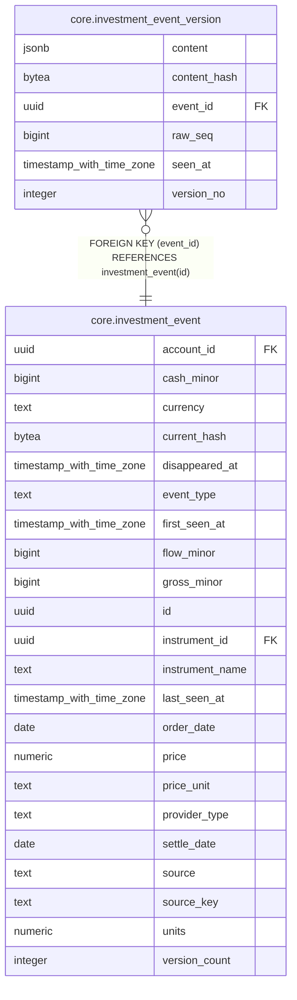

# core.investment_event_version

## Columns

| Name | Type | Default | Nullable | Children | Parents | Comment |
| ---- | ---- | ------- | -------- | -------- | ------- | ------- |
| content | jsonb |  | false |  |  |  |
| content_hash | bytea |  | false |  |  |  |
| event_id | uuid |  | false |  | [core.investment_event](core.investment_event.md) |  |
| raw_seq | bigint |  | false |  |  |  |
| seen_at | timestamp with time zone |  | false |  |  |  |
| version_no | integer |  | false |  |  |  |

## Constraints

| Name | Type | Definition |
| ---- | ---- | ---------- |
| investment_event_version_content_hash_not_null | n | NOT NULL content_hash |
| investment_event_version_content_not_null | n | NOT NULL content |
| investment_event_version_event_id_fkey | FOREIGN KEY | FOREIGN KEY (event_id) REFERENCES investment_event(id) |
| investment_event_version_event_id_not_null | n | NOT NULL event_id |
| investment_event_version_pkey | PRIMARY KEY | PRIMARY KEY (event_id, version_no) |
| investment_event_version_raw_seq_not_null | n | NOT NULL raw_seq |
| investment_event_version_seen_at_not_null | n | NOT NULL seen_at |
| investment_event_version_version_no_not_null | n | NOT NULL version_no |

## Indexes

| Name | Definition |
| ---- | ---------- |
| investment_event_version_pkey | CREATE UNIQUE INDEX investment_event_version_pkey ON core.investment_event_version USING btree (event_id, version_no) |

## Relations

---

> Generated by [tbls](https://github.com/k1LoW/tbls)
