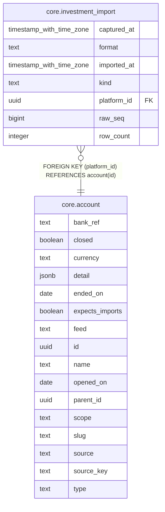

# core.investment_import

## Columns

| Name | Type | Default | Nullable | Children | Parents | Comment |
| ---- | ---- | ------- | -------- | -------- | ------- | ------- |
| captured_at | timestamp with time zone |  | true |  |  |  |
| format | text |  | false |  |  |  |
| imported_at | timestamp with time zone |  | false |  |  |  |
| kind | text |  | false |  |  |  |
| platform_id | uuid |  | false |  | [core.account](core.account.md) |  |
| raw_seq | bigint |  | false |  |  |  |
| row_count | integer |  | false |  |  |  |

## Constraints

| Name | Type | Definition |
| ---- | ---- | ---------- |
| investment_import_format_not_null | n | NOT NULL format |
| investment_import_imported_at_not_null | n | NOT NULL imported_at |
| investment_import_kind_check | CHECK | CHECK ((kind = ANY (ARRAY['ledger'::text, 'holdings'::text, 'capture'::text, 'statement'::text, 'trade_note'::text]))) |
| investment_import_kind_not_null | n | NOT NULL kind |
| investment_import_pkey | PRIMARY KEY | PRIMARY KEY (raw_seq) |
| investment_import_platform_id_fkey | FOREIGN KEY | FOREIGN KEY (platform_id) REFERENCES account(id) |
| investment_import_platform_id_not_null | n | NOT NULL platform_id |
| investment_import_raw_seq_not_null | n | NOT NULL raw_seq |
| investment_import_row_count_not_null | n | NOT NULL row_count |

## Indexes

| Name | Definition |
| ---- | ---------- |
| investment_import_pkey | CREATE UNIQUE INDEX investment_import_pkey ON core.investment_import USING btree (raw_seq) |

## Relations

---

> Generated by [tbls](https://github.com/k1LoW/tbls)
