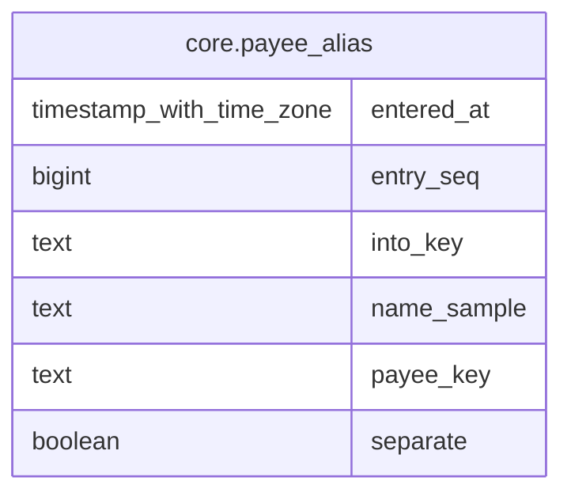

# core.payee_alias

## Columns

| Name | Type | Default | Nullable | Children | Parents | Comment |
| ---- | ---- | ------- | -------- | -------- | ------- | ------- |
| entered_at | timestamp with time zone |  | false |  |  |  |
| entry_seq | bigint |  | false |  |  |  |
| into_key | text |  | true |  |  |  |
| name_sample | text |  | true |  |  |  |
| payee_key | text |  | false |  |  |  |
| separate | boolean | false | false |  |  |  |

## Constraints

| Name | Type | Definition |
| ---- | ---- | ---------- |
| payee_alias_check | CHECK | CHECK ((separate OR (into_key IS NOT NULL))) |
| payee_alias_entered_at_not_null | n | NOT NULL entered_at |
| payee_alias_entry_seq_not_null | n | NOT NULL entry_seq |
| payee_alias_payee_key_not_null | n | NOT NULL payee_key |
| payee_alias_pkey | PRIMARY KEY | PRIMARY KEY (payee_key) |
| payee_alias_separate_not_null | n | NOT NULL separate |

## Indexes

| Name | Definition |
| ---- | ---------- |
| payee_alias_pkey | CREATE UNIQUE INDEX payee_alias_pkey ON core.payee_alias USING btree (payee_key) |

## Relations

---

> Generated by [tbls](https://github.com/k1LoW/tbls)
