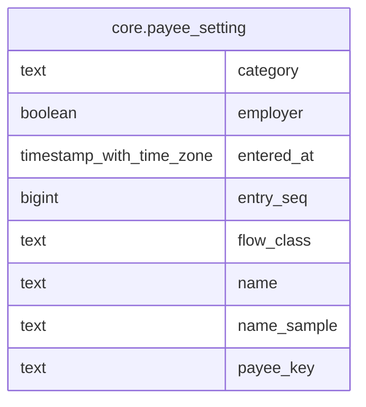

# core.payee_setting

## Columns

| Name | Type | Default | Nullable | Children | Parents | Comment |
| ---- | ---- | ------- | -------- | -------- | ------- | ------- |
| category | text |  | true |  |  |  |
| employer | boolean |  | true |  |  |  |
| entered_at | timestamp with time zone |  | false |  |  |  |
| entry_seq | bigint |  | false |  |  |  |
| flow_class | text |  | true |  |  |  |
| name | text |  | true |  |  |  |
| name_sample | text |  | true |  |  |  |
| payee_key | text |  | false |  |  |  |

## Constraints

| Name | Type | Definition |
| ---- | ---- | ---------- |
| payee_setting_entered_at_not_null | n | NOT NULL entered_at |
| payee_setting_entry_seq_not_null | n | NOT NULL entry_seq |
| payee_setting_flow_class_check | CHECK | CHECK ((flow_class = ANY (ARRAY['internal'::text, 'scope_transfer'::text, 'own_external'::text, 'investment'::text, 'debt_repayment'::text, 'income'::text, 'refund'::text, 'spending'::text]))) |
| payee_setting_payee_key_not_null | n | NOT NULL payee_key |
| payee_setting_pkey | PRIMARY KEY | PRIMARY KEY (payee_key) |

## Indexes

| Name | Definition |
| ---- | ---------- |
| payee_setting_pkey | CREATE UNIQUE INDEX payee_setting_pkey ON core.payee_setting USING btree (payee_key) |

## Relations

---

> Generated by [tbls](https://github.com/k1LoW/tbls)
