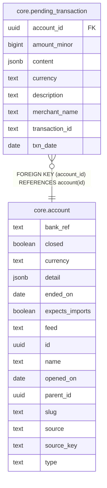

# core.pending_transaction

## Columns

| Name | Type | Default | Nullable | Children | Parents | Comment |
| ---- | ---- | ------- | -------- | -------- | ------- | ------- |
| account_id | uuid |  | false |  | [core.account](core.account.md) |  |
| amount_minor | bigint |  | false |  |  |  |
| content | jsonb |  | false |  |  |  |
| currency | text |  | false |  |  |  |
| description | text |  | false |  |  |  |
| merchant_name | text |  | true |  |  |  |
| transaction_id | text |  | false |  |  |  |
| txn_date | date |  | false |  |  |  |

## Constraints

| Name | Type | Definition |
| ---- | ---- | ---------- |
| pending_transaction_account_id_fkey | FOREIGN KEY | FOREIGN KEY (account_id) REFERENCES account(id) |
| pending_transaction_account_id_not_null | n | NOT NULL account_id |
| pending_transaction_amount_minor_not_null | n | NOT NULL amount_minor |
| pending_transaction_content_not_null | n | NOT NULL content |
| pending_transaction_currency_not_null | n | NOT NULL currency |
| pending_transaction_description_not_null | n | NOT NULL description |
| pending_transaction_pkey | PRIMARY KEY | PRIMARY KEY (account_id, transaction_id) |
| pending_transaction_transaction_id_not_null | n | NOT NULL transaction_id |
| pending_transaction_txn_date_not_null | n | NOT NULL txn_date |

## Indexes

| Name | Definition |
| ---- | ---------- |
| pending_transaction_pkey | CREATE UNIQUE INDEX pending_transaction_pkey ON core.pending_transaction USING btree (account_id, transaction_id) |

## Relations

---

> Generated by [tbls](https://github.com/k1LoW/tbls)
