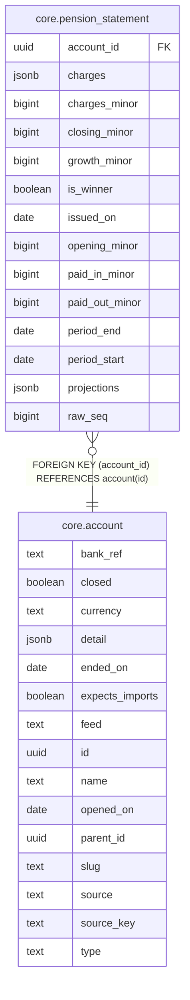

# core.pension_statement

## Columns

| Name | Type | Default | Nullable | Children | Parents | Comment |
| ---- | ---- | ------- | -------- | -------- | ------- | ------- |
| account_id | uuid |  | false |  | [core.account](core.account.md) |  |
| charges | jsonb |  | false |  |  |  |
| charges_minor | bigint |  | true |  |  |  |
| closing_minor | bigint |  | false |  |  |  |
| growth_minor | bigint |  | false |  |  |  |
| is_winner | boolean |  | false |  |  |  |
| issued_on | date |  | false |  |  |  |
| opening_minor | bigint |  | false |  |  |  |
| paid_in_minor | bigint |  | false |  |  |  |
| paid_out_minor | bigint |  | false |  |  |  |
| period_end | date |  | false |  |  |  |
| period_start | date |  | false |  |  |  |
| projections | jsonb |  | false |  |  |  |
| raw_seq | bigint |  | false |  |  |  |

## Constraints

| Name | Type | Definition |
| ---- | ---- | ---------- |
| pension_statement_account_id_fkey | FOREIGN KEY | FOREIGN KEY (account_id) REFERENCES account(id) |
| pension_statement_account_id_not_null | n | NOT NULL account_id |
| pension_statement_charges_not_null | n | NOT NULL charges |
| pension_statement_closing_minor_not_null | n | NOT NULL closing_minor |
| pension_statement_growth_minor_not_null | n | NOT NULL growth_minor |
| pension_statement_is_winner_not_null | n | NOT NULL is_winner |
| pension_statement_issued_on_not_null | n | NOT NULL issued_on |
| pension_statement_opening_minor_not_null | n | NOT NULL opening_minor |
| pension_statement_paid_in_minor_not_null | n | NOT NULL paid_in_minor |
| pension_statement_paid_out_minor_not_null | n | NOT NULL paid_out_minor |
| pension_statement_period_end_not_null | n | NOT NULL period_end |
| pension_statement_period_start_not_null | n | NOT NULL period_start |
| pension_statement_pkey | PRIMARY KEY | PRIMARY KEY (account_id, raw_seq) |
| pension_statement_projections_not_null | n | NOT NULL projections |
| pension_statement_raw_seq_not_null | n | NOT NULL raw_seq |

## Indexes

| Name | Definition |
| ---- | ---------- |
| pension_statement_pkey | CREATE UNIQUE INDEX pension_statement_pkey ON core.pension_statement USING btree (account_id, raw_seq) |

## Relations

---

> Generated by [tbls](https://github.com/k1LoW/tbls)
