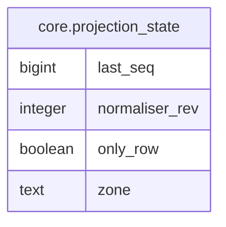

# core.projection_state

## Columns

| Name | Type | Default | Nullable | Children | Parents | Comment |
| ---- | ---- | ------- | -------- | -------- | ------- | ------- |
| last_seq | bigint |  | false |  |  |  |
| normaliser_rev | integer |  | false |  |  |  |
| only_row | boolean | true | false |  |  |  |
| zone | text |  | true |  |  |  |

## Constraints

| Name | Type | Definition |
| ---- | ---- | ---------- |
| projection_state_last_seq_not_null | n | NOT NULL last_seq |
| projection_state_normaliser_rev_not_null | n | NOT NULL normaliser_rev |
| projection_state_only_row_check | CHECK | CHECK (only_row) |
| projection_state_only_row_not_null | n | NOT NULL only_row |
| projection_state_pkey | PRIMARY KEY | PRIMARY KEY (only_row) |

## Indexes

| Name | Definition |
| ---- | ---------- |
| projection_state_pkey | CREATE UNIQUE INDEX projection_state_pkey ON core.projection_state USING btree (only_row) |

## Relations

---

> Generated by [tbls](https://github.com/k1LoW/tbls)
