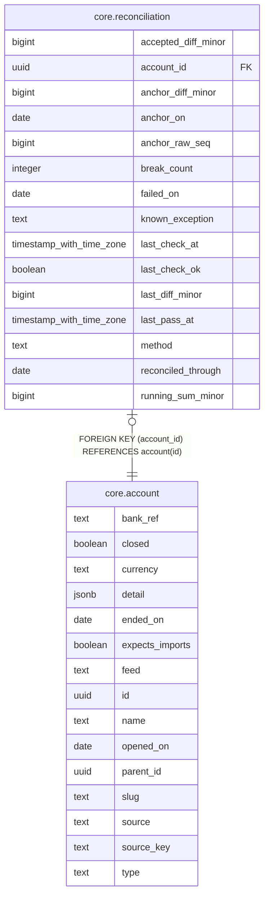

# core.reconciliation

## Columns

| Name | Type | Default | Nullable | Children | Parents | Comment |
| ---- | ---- | ------- | -------- | -------- | ------- | ------- |
| accepted_diff_minor | bigint |  | true |  |  |  |
| account_id | uuid |  | false |  | [core.account](core.account.md) |  |
| anchor_diff_minor | bigint |  | true |  |  |  |
| anchor_on | date |  | true |  |  |  |
| anchor_raw_seq | bigint |  | true |  |  |  |
| break_count | integer | 0 | false |  |  |  |
| failed_on | date |  | true |  |  |  |
| known_exception | text |  | true |  |  |  |
| last_check_at | timestamp with time zone |  | true |  |  |  |
| last_check_ok | boolean |  | true |  |  |  |
| last_diff_minor | bigint |  | true |  |  |  |
| last_pass_at | timestamp with time zone |  | true |  |  |  |
| method | text |  | false |  |  |  |
| reconciled_through | date |  | true |  |  |  |
| running_sum_minor | bigint | 0 | false |  |  |  |

## Constraints

| Name | Type | Definition |
| ---- | ---- | ---------- |
| reconciliation_account_id_fkey | FOREIGN KEY | FOREIGN KEY (account_id) REFERENCES account(id) |
| reconciliation_account_id_not_null | n | NOT NULL account_id |
| reconciliation_break_count_not_null | n | NOT NULL break_count |
| reconciliation_method_not_null | n | NOT NULL method |
| reconciliation_pkey | PRIMARY KEY | PRIMARY KEY (account_id) |
| reconciliation_running_sum_minor_not_null | n | NOT NULL running_sum_minor |

## Indexes

| Name | Definition |
| ---- | ---------- |
| reconciliation_pkey | CREATE UNIQUE INDEX reconciliation_pkey ON core.reconciliation USING btree (account_id) |

## Relations

---

> Generated by [tbls](https://github.com/k1LoW/tbls)
