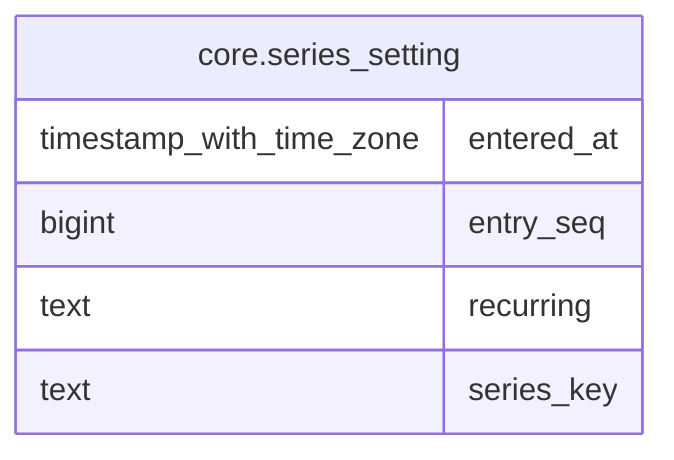

# core.series_setting

## Columns

| Name | Type | Default | Nullable | Children | Parents | Comment |
| ---- | ---- | ------- | -------- | -------- | ------- | ------- |
| entered_at | timestamp with time zone |  | false |  |  |  |
| entry_seq | bigint |  | false |  |  |  |
| recurring | text |  | false |  |  |  |
| series_key | text |  | false |  |  |  |

## Constraints

| Name | Type | Definition |
| ---- | ---- | ---------- |
| series_setting_entered_at_not_null | n | NOT NULL entered_at |
| series_setting_entry_seq_not_null | n | NOT NULL entry_seq |
| series_setting_pkey | PRIMARY KEY | PRIMARY KEY (series_key) |
| series_setting_recurring_check | CHECK | CHECK ((recurring = ANY (ARRAY['confirm'::text, 'ignore'::text, 'not_recurring'::text]))) |
| series_setting_recurring_not_null | n | NOT NULL recurring |
| series_setting_series_key_not_null | n | NOT NULL series_key |

## Indexes

| Name | Definition |
| ---- | ---------- |
| series_setting_pkey | CREATE UNIQUE INDEX series_setting_pkey ON core.series_setting USING btree (series_key) |

## Relations

---

> Generated by [tbls](https://github.com/k1LoW/tbls)
