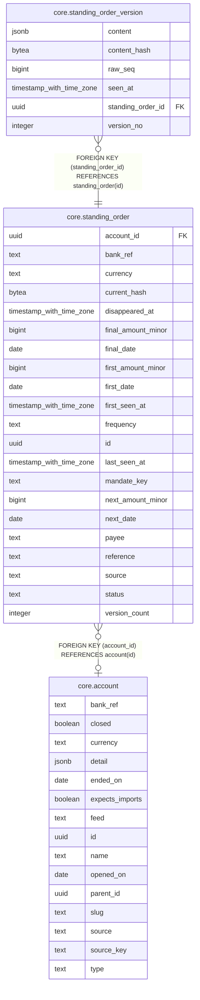

# core.standing_order

## Columns

| Name | Type | Default | Nullable | Children | Parents | Comment |
| ---- | ---- | ------- | -------- | -------- | ------- | ------- |
| account_id | uuid |  | true |  | [core.account](core.account.md) |  |
| bank_ref | text |  | false |  |  |  |
| currency | text |  | true |  |  |  |
| current_hash | bytea |  | false |  |  |  |
| disappeared_at | timestamp with time zone |  | true |  |  |  |
| final_amount_minor | bigint |  | true |  |  |  |
| final_date | date |  | true |  |  |  |
| first_amount_minor | bigint |  | true |  |  |  |
| first_date | date |  | true |  |  |  |
| first_seen_at | timestamp with time zone |  | false |  |  |  |
| frequency | text |  | true |  |  |  |
| id | uuid |  | false | [core.standing_order_version](core.standing_order_version.md) |  |  |
| last_seen_at | timestamp with time zone |  | false |  |  |  |
| mandate_key | text |  | false |  |  |  |
| next_amount_minor | bigint |  | true |  |  |  |
| next_date | date |  | true |  |  |  |
| payee | text |  | true |  |  |  |
| reference | text |  | true |  |  |  |
| source | text |  | false |  |  |  |
| status | text |  | true |  |  |  |
| version_count | integer |  | false |  |  |  |

## Constraints

| Name | Type | Definition |
| ---- | ---- | ---------- |
| standing_order_account_id_fkey | FOREIGN KEY | FOREIGN KEY (account_id) REFERENCES account(id) |
| standing_order_bank_ref_not_null | n | NOT NULL bank_ref |
| standing_order_current_hash_not_null | n | NOT NULL current_hash |
| standing_order_first_seen_at_not_null | n | NOT NULL first_seen_at |
| standing_order_id_not_null | n | NOT NULL id |
| standing_order_last_seen_at_not_null | n | NOT NULL last_seen_at |
| standing_order_mandate_key_not_null | n | NOT NULL mandate_key |
| standing_order_pkey | PRIMARY KEY | PRIMARY KEY (id) |
| standing_order_source_bank_ref_mandate_key_key | UNIQUE | UNIQUE (source, bank_ref, mandate_key) |
| standing_order_source_not_null | n | NOT NULL source |
| standing_order_version_count_not_null | n | NOT NULL version_count |

## Indexes

| Name | Definition |
| ---- | ---------- |
| standing_order_pkey | CREATE UNIQUE INDEX standing_order_pkey ON core.standing_order USING btree (id) |
| standing_order_source_bank_ref_mandate_key_key | CREATE UNIQUE INDEX standing_order_source_bank_ref_mandate_key_key ON core.standing_order USING btree (source, bank_ref, mandate_key) |

## Relations

---

> Generated by [tbls](https://github.com/k1LoW/tbls)
