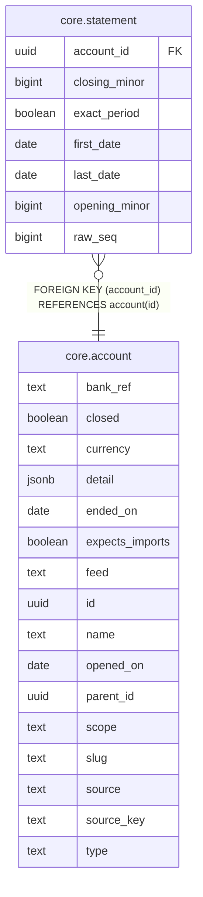

# core.statement

## Columns

| Name | Type | Default | Nullable | Children | Parents | Comment |
| ---- | ---- | ------- | -------- | -------- | ------- | ------- |
| account_id | uuid |  | false |  | [core.account](core.account.md) |  |
| closing_minor | bigint |  | false |  |  |  |
| exact_period | boolean | false | false |  |  |  |
| first_date | date |  | false |  |  |  |
| last_date | date |  | false |  |  |  |
| opening_minor | bigint |  | false |  |  |  |
| raw_seq | bigint |  | false |  |  |  |

## Constraints

| Name | Type | Definition |
| ---- | ---- | ---------- |
| statement_account_id_fkey | FOREIGN KEY | FOREIGN KEY (account_id) REFERENCES account(id) |
| statement_account_id_not_null | n | NOT NULL account_id |
| statement_closing_minor_not_null | n | NOT NULL closing_minor |
| statement_exact_period_not_null | n | NOT NULL exact_period |
| statement_first_date_not_null | n | NOT NULL first_date |
| statement_last_date_not_null | n | NOT NULL last_date |
| statement_opening_minor_not_null | n | NOT NULL opening_minor |
| statement_pkey | PRIMARY KEY | PRIMARY KEY (account_id, raw_seq) |
| statement_raw_seq_not_null | n | NOT NULL raw_seq |

## Indexes

| Name | Definition |
| ---- | ---------- |
| statement_pkey | CREATE UNIQUE INDEX statement_pkey ON core.statement USING btree (account_id, raw_seq) |

## Relations

---

> Generated by [tbls](https://github.com/k1LoW/tbls)
