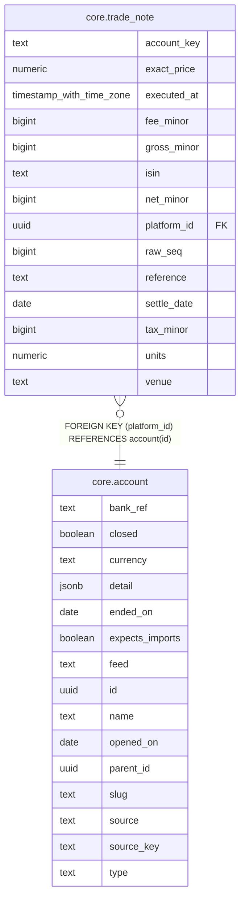

# core.trade_note

## Columns

| Name | Type | Default | Nullable | Children | Parents | Comment |
| ---- | ---- | ------- | -------- | -------- | ------- | ------- |
| account_key | text |  | false |  |  |  |
| exact_price | numeric |  | false |  |  |  |
| executed_at | timestamp with time zone |  | false |  |  |  |
| fee_minor | bigint |  | false |  |  |  |
| gross_minor | bigint |  | false |  |  |  |
| isin | text |  | false |  |  |  |
| net_minor | bigint |  | false |  |  |  |
| platform_id | uuid |  | false |  | [core.account](core.account.md) |  |
| raw_seq | bigint |  | false |  |  |  |
| reference | text |  | false |  |  |  |
| settle_date | date |  | false |  |  |  |
| tax_minor | bigint |  | false |  |  |  |
| units | numeric |  | false |  |  |  |
| venue | text |  | true |  |  |  |

## Constraints

| Name | Type | Definition |
| ---- | ---- | ---------- |
| trade_note_account_key_not_null | n | NOT NULL account_key |
| trade_note_exact_price_not_null | n | NOT NULL exact_price |
| trade_note_executed_at_not_null | n | NOT NULL executed_at |
| trade_note_fee_minor_not_null | n | NOT NULL fee_minor |
| trade_note_gross_minor_not_null | n | NOT NULL gross_minor |
| trade_note_isin_not_null | n | NOT NULL isin |
| trade_note_net_minor_not_null | n | NOT NULL net_minor |
| trade_note_pkey | PRIMARY KEY | PRIMARY KEY (platform_id, account_key, reference) |
| trade_note_platform_id_fkey | FOREIGN KEY | FOREIGN KEY (platform_id) REFERENCES account(id) |
| trade_note_platform_id_not_null | n | NOT NULL platform_id |
| trade_note_raw_seq_not_null | n | NOT NULL raw_seq |
| trade_note_reference_not_null | n | NOT NULL reference |
| trade_note_settle_date_not_null | n | NOT NULL settle_date |
| trade_note_tax_minor_not_null | n | NOT NULL tax_minor |
| trade_note_units_not_null | n | NOT NULL units |

## Indexes

| Name | Definition |
| ---- | ---------- |
| trade_note_pkey | CREATE UNIQUE INDEX trade_note_pkey ON core.trade_note USING btree (platform_id, account_key, reference) |

## Relations

---

> Generated by [tbls](https://github.com/k1LoW/tbls)
