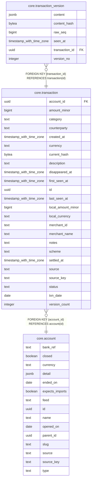

# core.transaction

## Columns

| Name | Type | Default | Nullable | Children | Parents | Comment |
| ---- | ---- | ------- | -------- | -------- | ------- | ------- |
| account_id | uuid |  | false |  | [core.account](core.account.md) |  |
| amount_minor | bigint |  | false |  |  |  |
| category | text |  | true |  |  |  |
| counterparty | text |  | true |  |  |  |
| created_at | timestamp with time zone |  | true |  |  |  |
| currency | text |  | false |  |  |  |
| current_hash | bytea |  | false |  |  |  |
| description | text |  | false |  |  |  |
| disappeared_at | timestamp with time zone |  | true |  |  |  |
| first_seen_at | timestamp with time zone |  | false |  |  |  |
| id | uuid |  | false | [core.transaction_version](core.transaction_version.md) |  |  |
| last_seen_at | timestamp with time zone |  | false |  |  |  |
| local_amount_minor | bigint |  | true |  |  |  |
| local_currency | text |  | true |  |  |  |
| merchant_id | text |  | true |  |  |  |
| merchant_name | text |  | true |  |  |  |
| notes | text |  | true |  |  |  |
| scheme | text |  | true |  |  |  |
| settled_at | timestamp with time zone |  | true |  |  |  |
| source | text |  | false |  |  |  |
| source_key | text |  | false |  |  |  |
| status | text |  | false |  |  |  |
| txn_date | date |  | false |  |  |  |
| version_count | integer |  | false |  |  |  |

## Constraints

| Name | Type | Definition |
| ---- | ---- | ---------- |
| transaction_account_id_fkey | FOREIGN KEY | FOREIGN KEY (account_id) REFERENCES account(id) |
| transaction_account_id_not_null | n | NOT NULL account_id |
| transaction_account_id_source_source_key_key | UNIQUE | UNIQUE (account_id, source, source_key) |
| transaction_amount_minor_not_null | n | NOT NULL amount_minor |
| transaction_currency_not_null | n | NOT NULL currency |
| transaction_current_hash_not_null | n | NOT NULL current_hash |
| transaction_description_not_null | n | NOT NULL description |
| transaction_first_seen_at_not_null | n | NOT NULL first_seen_at |
| transaction_id_not_null | n | NOT NULL id |
| transaction_last_seen_at_not_null | n | NOT NULL last_seen_at |
| transaction_pkey | PRIMARY KEY | PRIMARY KEY (id) |
| transaction_source_key_not_null | n | NOT NULL source_key |
| transaction_source_not_null | n | NOT NULL source |
| transaction_status_check | CHECK | CHECK ((status = ANY (ARRAY['pending'::text, 'settled'::text, 'declined'::text]))) |
| transaction_status_not_null | n | NOT NULL status |
| transaction_txn_date_not_null | n | NOT NULL txn_date |
| transaction_version_count_not_null | n | NOT NULL version_count |

## Indexes

| Name | Definition |
| ---- | ---------- |
| transaction_account_created | CREATE INDEX transaction_account_created ON core.transaction USING btree (account_id, created_at) |
| transaction_account_date | CREATE INDEX transaction_account_date ON core.transaction USING btree (account_id, txn_date) |
| transaction_account_id_source_source_key_key | CREATE UNIQUE INDEX transaction_account_id_source_source_key_key ON core.transaction USING btree (account_id, source, source_key) |
| transaction_pkey | CREATE UNIQUE INDEX transaction_pkey ON core.transaction USING btree (id) |

## Relations

---

> Generated by [tbls](https://github.com/k1LoW/tbls)
