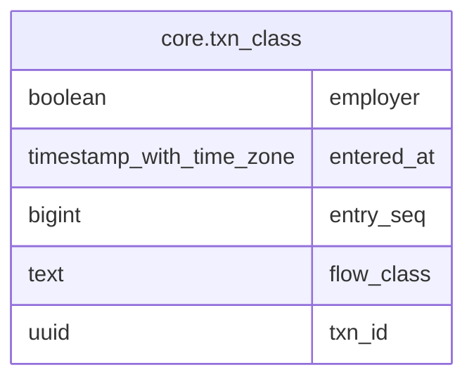

# core.txn_class

## Columns

| Name | Type | Default | Nullable | Children | Parents | Comment |
| ---- | ---- | ------- | -------- | -------- | ------- | ------- |
| employer | boolean | false | false |  |  |  |
| entered_at | timestamp with time zone |  | false |  |  |  |
| entry_seq | bigint |  | false |  |  |  |
| flow_class | text |  | false |  |  |  |
| txn_id | uuid |  | false |  |  |  |

## Constraints

| Name | Type | Definition |
| ---- | ---- | ---------- |
| txn_class_check | CHECK | CHECK (((NOT employer) OR (flow_class = 'income'::text))) |
| txn_class_employer_not_null | n | NOT NULL employer |
| txn_class_entered_at_not_null | n | NOT NULL entered_at |
| txn_class_entry_seq_not_null | n | NOT NULL entry_seq |
| txn_class_flow_class_check | CHECK | CHECK ((flow_class = ANY (ARRAY['internal'::text, 'scope_transfer'::text, 'own_external'::text, 'investment'::text, 'debt_repayment'::text, 'borrowing'::text, 'income'::text, 'refund'::text, 'spending'::text]))) |
| txn_class_flow_class_not_null | n | NOT NULL flow_class |
| txn_class_pkey | PRIMARY KEY | PRIMARY KEY (txn_id) |
| txn_class_txn_id_not_null | n | NOT NULL txn_id |

## Indexes

| Name | Definition |
| ---- | ---------- |
| txn_class_pkey | CREATE UNIQUE INDEX txn_class_pkey ON core.txn_class USING btree (txn_id) |

## Relations

---

> Generated by [tbls](https://github.com/k1LoW/tbls)
