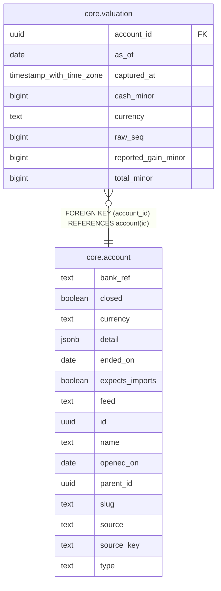

# core.valuation

## Columns

| Name | Type | Default | Nullable | Children | Parents | Comment |
| ---- | ---- | ------- | -------- | -------- | ------- | ------- |
| account_id | uuid |  | false |  | [core.account](core.account.md) |  |
| as_of | date |  | false |  |  |  |
| captured_at | timestamp with time zone |  | false |  |  |  |
| cash_minor | bigint |  | false |  |  |  |
| currency | text |  | false |  |  |  |
| raw_seq | bigint |  | false |  |  |  |
| reported_gain_minor | bigint |  | true |  |  |  |
| total_minor | bigint |  | false |  |  |  |

## Constraints

| Name | Type | Definition |
| ---- | ---- | ---------- |
| valuation_account_id_fkey | FOREIGN KEY | FOREIGN KEY (account_id) REFERENCES account(id) |
| valuation_account_id_not_null | n | NOT NULL account_id |
| valuation_as_of_not_null | n | NOT NULL as_of |
| valuation_captured_at_not_null | n | NOT NULL captured_at |
| valuation_cash_minor_not_null | n | NOT NULL cash_minor |
| valuation_currency_not_null | n | NOT NULL currency |
| valuation_pkey | PRIMARY KEY | PRIMARY KEY (account_id, raw_seq) |
| valuation_raw_seq_not_null | n | NOT NULL raw_seq |
| valuation_total_minor_not_null | n | NOT NULL total_minor |

## Indexes

| Name | Definition |
| ---- | ---------- |
| valuation_pkey | CREATE UNIQUE INDEX valuation_pkey ON core.valuation USING btree (account_id, raw_seq) |

## Relations

---

> Generated by [tbls](https://github.com/k1LoW/tbls)
