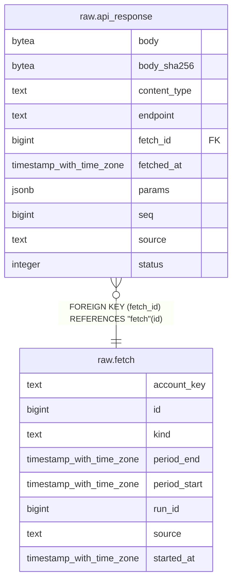

# raw.api_response

## Columns

| Name | Type | Default | Nullable | Children | Parents | Comment |
| ---- | ---- | ------- | -------- | -------- | ------- | ------- |
| body | bytea |  | false |  |  |  |
| body_sha256 | bytea |  | false |  |  |  |
| content_type | text |  | false |  |  |  |
| endpoint | text |  | false |  |  |  |
| fetch_id | bigint |  | false |  | [raw.fetch](raw.fetch.md) |  |
| fetched_at | timestamp with time zone |  | false |  |  |  |
| params | jsonb |  | false |  |  |  |
| seq | bigint | nextval('seq'::regclass) | false |  |  |  |
| source | text |  | false |  |  |  |
| status | integer |  | false |  |  |  |

## Constraints

| Name | Type | Definition |
| ---- | ---- | ---------- |
| api_response_body_not_null | n | NOT NULL body |
| api_response_body_sha256_not_null | n | NOT NULL body_sha256 |
| api_response_content_type_not_null | n | NOT NULL content_type |
| api_response_endpoint_not_null | n | NOT NULL endpoint |
| api_response_fetch_id_fkey | FOREIGN KEY | FOREIGN KEY (fetch_id) REFERENCES "fetch"(id) |
| api_response_fetch_id_not_null | n | NOT NULL fetch_id |
| api_response_fetched_at_not_null | n | NOT NULL fetched_at |
| api_response_params_not_null | n | NOT NULL params |
| api_response_pkey | PRIMARY KEY | PRIMARY KEY (seq) |
| api_response_seq_not_null | n | NOT NULL seq |
| api_response_source_not_null | n | NOT NULL source |
| api_response_status_not_null | n | NOT NULL status |

## Indexes

| Name | Definition |
| ---- | ---------- |
| api_response_capture_key | CREATE INDEX api_response_capture_key ON raw.api_response USING btree (endpoint, fetched_at, body_sha256) |
| api_response_fetch | CREATE INDEX api_response_fetch ON raw.api_response USING btree (fetch_id, seq) |
| api_response_pkey | CREATE UNIQUE INDEX api_response_pkey ON raw.api_response USING btree (seq) |

## Relations

---

> Generated by [tbls](https://github.com/k1LoW/tbls)
