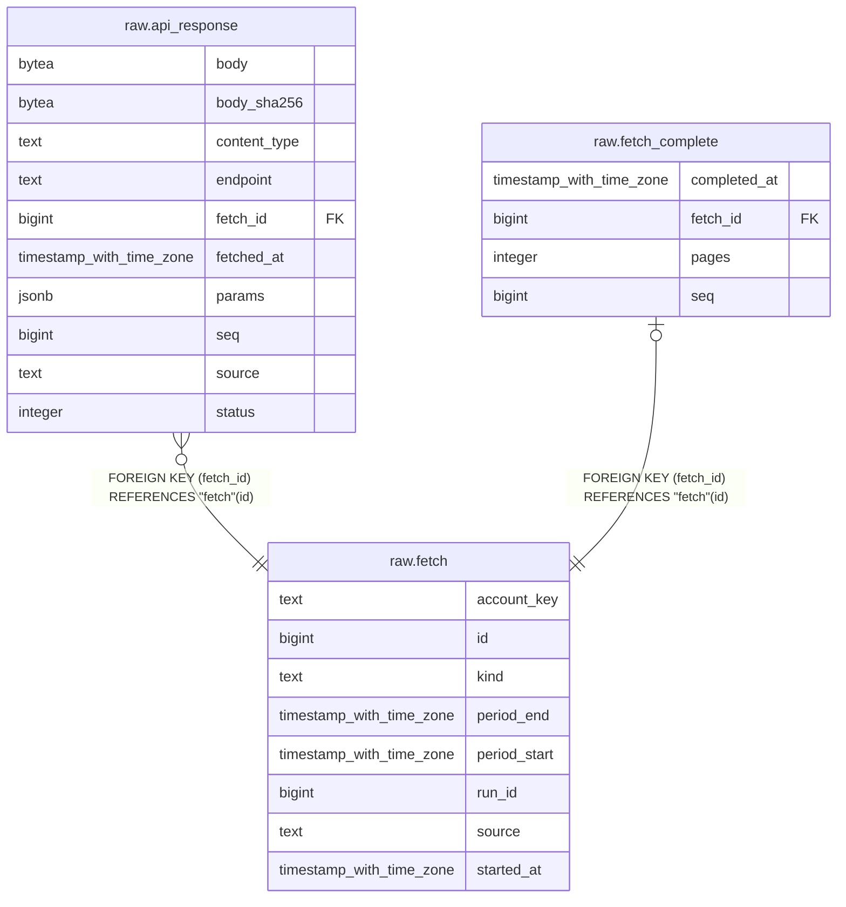

# raw.fetch

## Columns

| Name | Type | Default | Nullable | Children | Parents | Comment |
| ---- | ---- | ------- | -------- | -------- | ------- | ------- |
| account_key | text |  | true |  |  |  |
| id | bigint | nextval('seq'::regclass) | false | [raw.api_response](raw.api_response.md) [raw.fetch_complete](raw.fetch_complete.md) |  |  |
| kind | text |  | false |  |  |  |
| period_end | timestamp with time zone |  | true |  |  |  |
| period_start | timestamp with time zone |  | true |  |  |  |
| run_id | bigint |  | false |  |  |  |
| source | text |  | false |  |  |  |
| started_at | timestamp with time zone |  | false |  |  |  |

## Constraints

| Name | Type | Definition |
| ---- | ---- | ---------- |
| fetch_id_not_null | n | NOT NULL id |
| fetch_kind_not_null | n | NOT NULL kind |
| fetch_pkey | PRIMARY KEY | PRIMARY KEY (id) |
| fetch_run_id_not_null | n | NOT NULL run_id |
| fetch_source_not_null | n | NOT NULL source |
| fetch_started_at_not_null | n | NOT NULL started_at |

## Indexes

| Name | Definition |
| ---- | ---------- |
| fetch_account | CREATE INDEX fetch_account ON raw."fetch" USING btree (source, account_key) |
| fetch_pkey | CREATE UNIQUE INDEX fetch_pkey ON raw."fetch" USING btree (id) |
| fetch_run | CREATE INDEX fetch_run ON raw."fetch" USING btree (run_id, account_key) |

## Relations

---

> Generated by [tbls](https://github.com/k1LoW/tbls)
