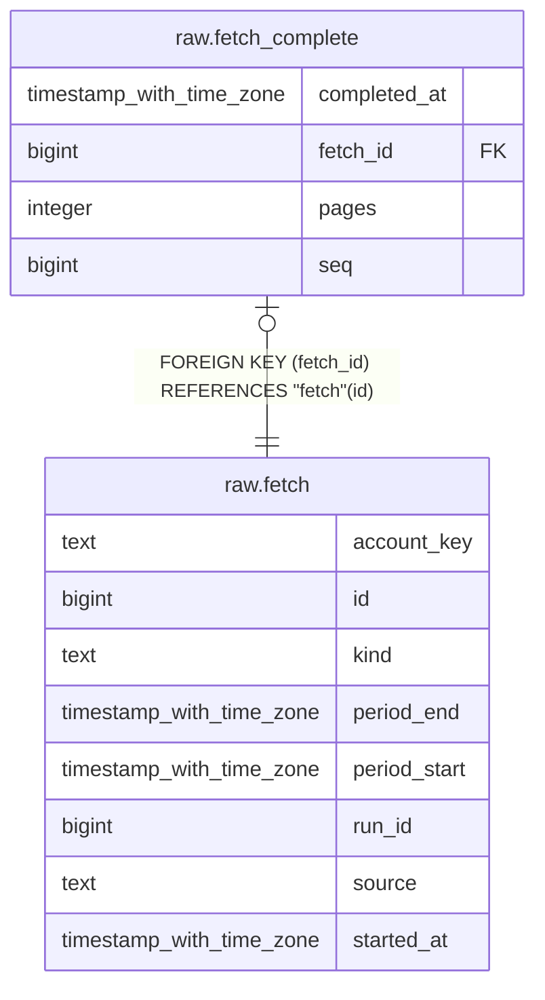

# raw.fetch_complete

## Columns

| Name | Type | Default | Nullable | Children | Parents | Comment |
| ---- | ---- | ------- | -------- | -------- | ------- | ------- |
| completed_at | timestamp with time zone |  | false |  |  |  |
| fetch_id | bigint |  | false |  | [raw.fetch](raw.fetch.md) |  |
| pages | integer |  | false |  |  |  |
| seq | bigint | nextval('seq'::regclass) | false |  |  |  |

## Constraints

| Name | Type | Definition |
| ---- | ---- | ---------- |
| fetch_complete_completed_at_not_null | n | NOT NULL completed_at |
| fetch_complete_fetch_id_fkey | FOREIGN KEY | FOREIGN KEY (fetch_id) REFERENCES "fetch"(id) |
| fetch_complete_fetch_id_key | UNIQUE | UNIQUE (fetch_id) |
| fetch_complete_fetch_id_not_null | n | NOT NULL fetch_id |
| fetch_complete_pages_not_null | n | NOT NULL pages |
| fetch_complete_pkey | PRIMARY KEY | PRIMARY KEY (seq) |
| fetch_complete_seq_not_null | n | NOT NULL seq |

## Indexes

| Name | Definition |
| ---- | ---------- |
| fetch_complete_fetch_id_key | CREATE UNIQUE INDEX fetch_complete_fetch_id_key ON raw.fetch_complete USING btree (fetch_id) |
| fetch_complete_pkey | CREATE UNIQUE INDEX fetch_complete_pkey ON raw.fetch_complete USING btree (seq) |

## Relations

---

> Generated by [tbls](https://github.com/k1LoW/tbls)
