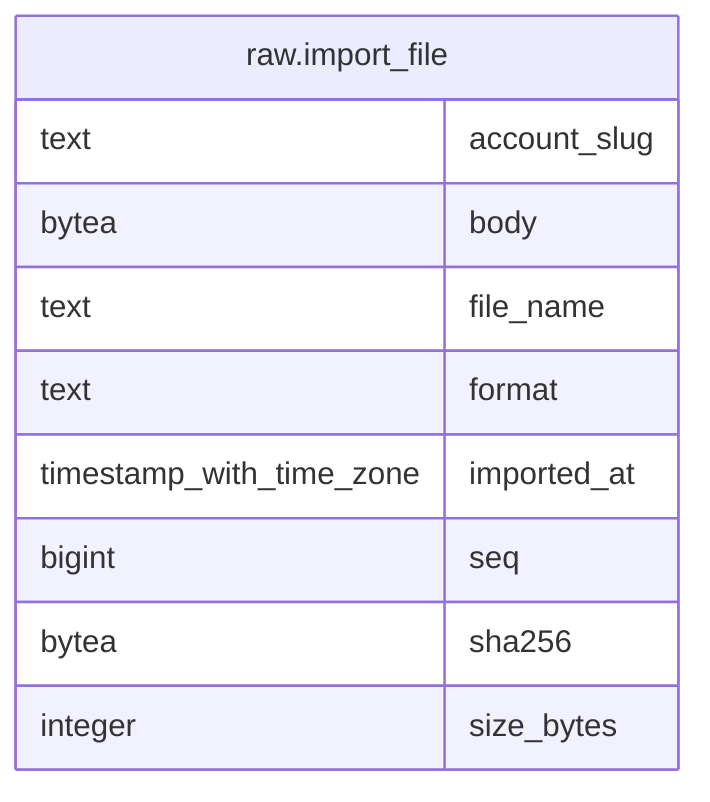

# raw.import_file

## Columns

| Name | Type | Default | Nullable | Children | Parents | Comment |
| ---- | ---- | ------- | -------- | -------- | ------- | ------- |
| account_slug | text |  | false |  |  |  |
| body | bytea |  | false |  |  |  |
| file_name | text |  | false |  |  |  |
| format | text |  | false |  |  |  |
| imported_at | timestamp with time zone |  | false |  |  |  |
| seq | bigint | nextval('seq'::regclass) | false |  |  |  |
| sha256 | bytea |  | false |  |  |  |
| size_bytes | integer |  | false |  |  |  |

## Constraints

| Name | Type | Definition |
| ---- | ---- | ---------- |
| import_file_account_slug_format_sha256_key | UNIQUE | UNIQUE (account_slug, format, sha256) |
| import_file_account_slug_not_null | n | NOT NULL account_slug |
| import_file_body_not_null | n | NOT NULL body |
| import_file_file_name_not_null | n | NOT NULL file_name |
| import_file_format_not_null | n | NOT NULL format |
| import_file_imported_at_not_null | n | NOT NULL imported_at |
| import_file_pkey | PRIMARY KEY | PRIMARY KEY (seq) |
| import_file_seq_not_null | n | NOT NULL seq |
| import_file_sha256_not_null | n | NOT NULL sha256 |
| import_file_size_bytes_not_null | n | NOT NULL size_bytes |

## Indexes

| Name | Definition |
| ---- | ---------- |
| import_file_account_slug_format_sha256_key | CREATE UNIQUE INDEX import_file_account_slug_format_sha256_key ON raw.import_file USING btree (account_slug, format, sha256) |
| import_file_pkey | CREATE UNIQUE INDEX import_file_pkey ON raw.import_file USING btree (seq) |

## Relations

---

> Generated by [tbls](https://github.com/k1LoW/tbls)
