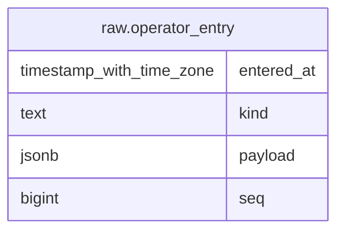

# raw.operator_entry

## Columns

| Name | Type | Default | Nullable | Children | Parents | Comment |
| ---- | ---- | ------- | -------- | -------- | ------- | ------- |
| entered_at | timestamp with time zone |  | false |  |  |  |
| kind | text |  | false |  |  |  |
| payload | jsonb |  | false |  |  |  |
| seq | bigint | nextval('seq'::regclass) | false |  |  |  |

## Constraints

| Name | Type | Definition |
| ---- | ---- | ---------- |
| operator_entry_entered_at_not_null | n | NOT NULL entered_at |
| operator_entry_kind_not_null | n | NOT NULL kind |
| operator_entry_payload_not_null | n | NOT NULL payload |
| operator_entry_pkey | PRIMARY KEY | PRIMARY KEY (seq) |
| operator_entry_seq_not_null | n | NOT NULL seq |

## Indexes

| Name | Definition |
| ---- | ---------- |
| operator_entry_pkey | CREATE UNIQUE INDEX operator_entry_pkey ON raw.operator_entry USING btree (seq) |

## Relations

---

> Generated by [tbls](https://github.com/k1LoW/tbls)
