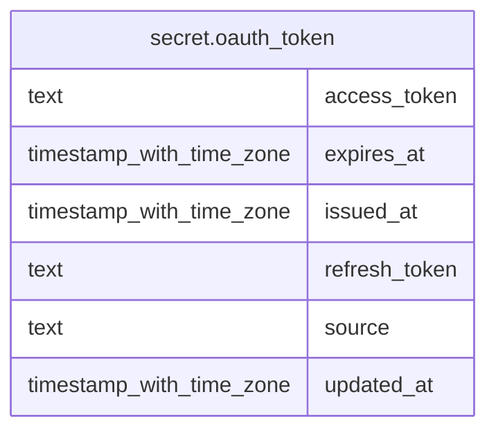

# secret.oauth_token

## Columns

| Name | Type | Default | Nullable | Children | Parents | Comment |
| ---- | ---- | ------- | -------- | -------- | ------- | ------- |
| access_token | text |  | false |  |  |  |
| expires_at | timestamp with time zone |  | false |  |  |  |
| issued_at | timestamp with time zone |  | false |  |  |  |
| refresh_token | text |  | false |  |  |  |
| source | text |  | false |  |  |  |
| updated_at | timestamp with time zone |  | false |  |  |  |

## Constraints

| Name | Type | Definition |
| ---- | ---- | ---------- |
| oauth_token_access_token_not_null | n | NOT NULL access_token |
| oauth_token_expires_at_not_null | n | NOT NULL expires_at |
| oauth_token_issued_at_not_null | n | NOT NULL issued_at |
| oauth_token_pkey | PRIMARY KEY | PRIMARY KEY (source) |
| oauth_token_refresh_token_not_null | n | NOT NULL refresh_token |
| oauth_token_source_not_null | n | NOT NULL source |
| oauth_token_updated_at_not_null | n | NOT NULL updated_at |

## Indexes

| Name | Definition |
| ---- | ---------- |
| oauth_token_pkey | CREATE UNIQUE INDEX oauth_token_pkey ON secret.oauth_token USING btree (source) |

## Relations

---

> Generated by [tbls](https://github.com/k1LoW/tbls)
